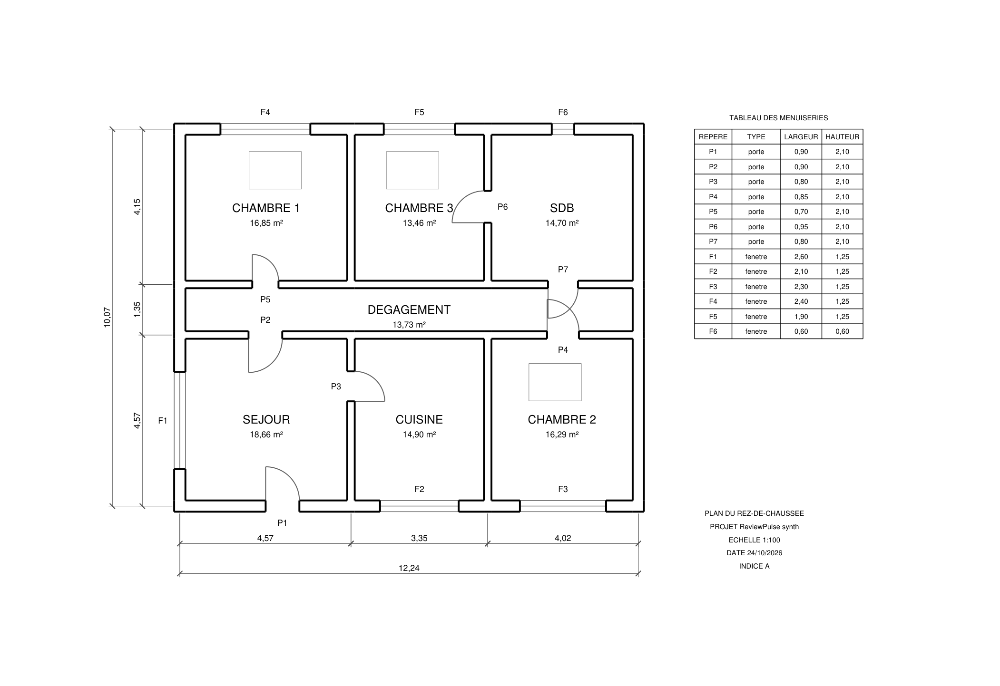
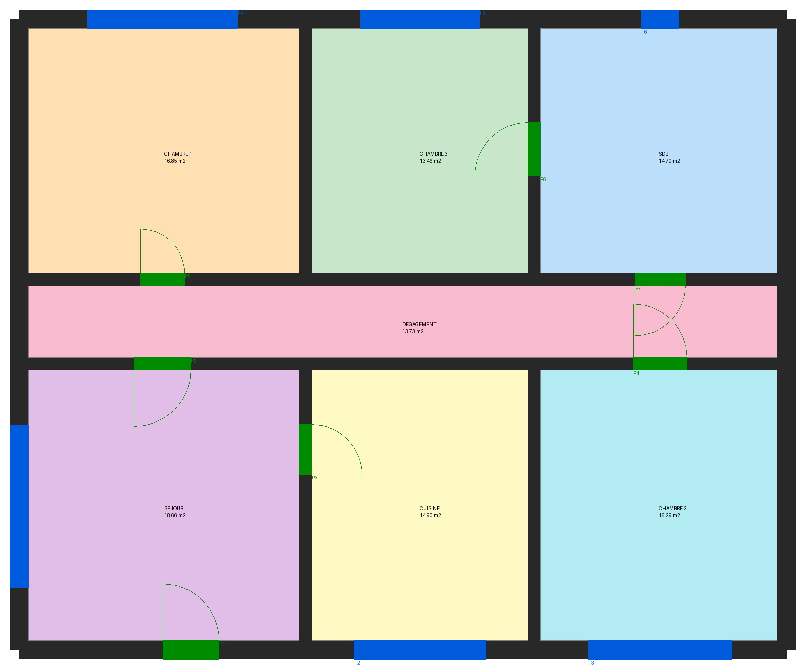
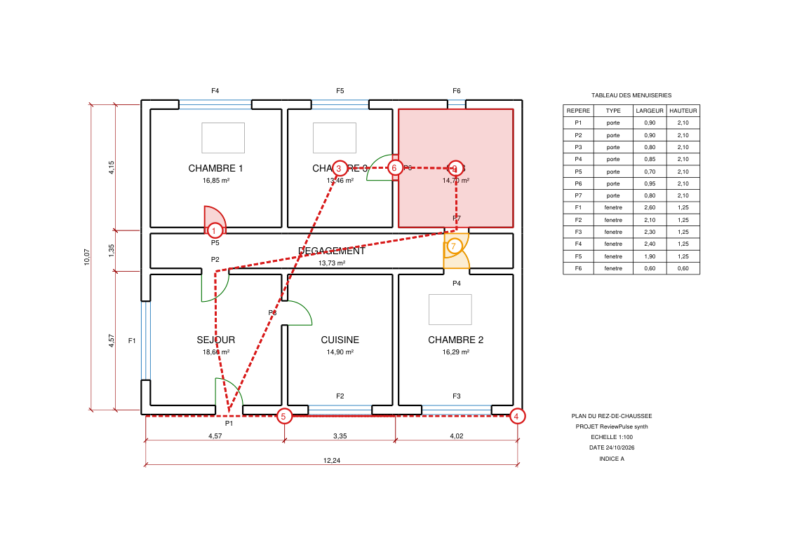
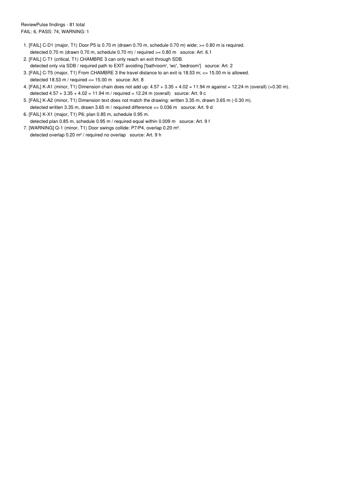
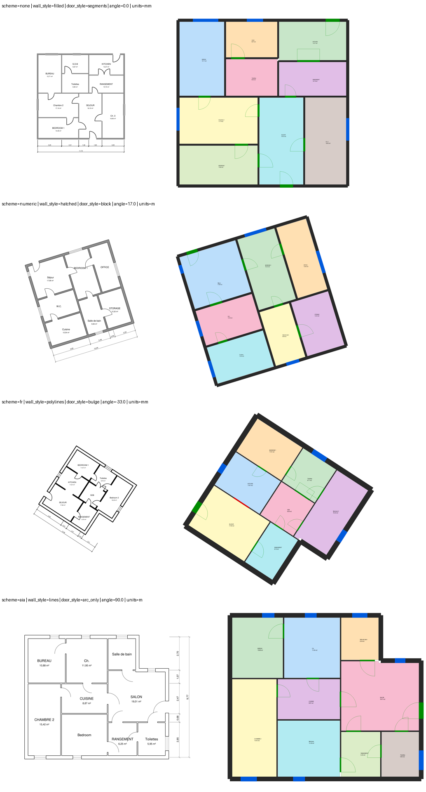

# Milestone 1: From a vector plan to proven findings

24 October 2026 · status after the first implementation sprint

## What works now

A vector plan (PDF or DXF) goes in; an annotated PDF and a self-contained HTML report come out.
Every finding names the rule, the clause it comes from, the detected and required values, its
confidence tier, and draws its proof on the drawing.

```
rp check plan.pdf
```

runs the whole chain: file type and mode (R1) → vector extraction (R2/R3) → drawing-style
normalisation → scale from the dimensions (R7) → walls (R8) → doors, windows, openings (R9) →
rooms and room graph (R10) → dimension chains (R11) → tags and schedule (R12) → tier (R14) →
22 approved rules (J1–J6) → reports (J7).

## A worked run

The test plan below carries five planted mistakes: a bedroom that can only reach the exit
through the bathroom, a 0.70 m door, a dimension written 0.30 m short, two door swings that
collide, and a schedule width that disagrees with the drawing.

**1. Input** (vector PDF at 1:100, generated with exact ground truth)



**2. What ReviewPulse understood.** Each colour is a room found as free space between walls.
Green marks doors (with their swing), blue marks windows. Labels and areas come from the drawing
text. The scale (1:100) was recovered from the dimension strings alone.



**3. The annotated report.** Red is FAIL, amber is WARNING. The dashed red line is the *witness*
for the bathroom rule: the only route from CHAMBRE 3 to the exit, with the blocking room shaded.



**4. Summary page.** Every finding states detected against required values and cites its clause.



All five planted mistakes were found (6 FAIL, 1 WARNING). The sixth FAIL is a true consequence:
the bathroom detour also pushes the travel distance to the exit to 18.5 m, over the 15 m limit.
The swing collision is a WARNING by design, because coordination issues are capped at WARNING.

## Does it generalise? Randomised plans

One fixed layout proves little, so a second generator draws a new plan every time:

- footprint: rectangle or L;
- room split: recursive;
- rotation: any angle;
- units: mm or m;
- scale: 1:50, 1:100 or 1:200;
- layer names: AIA (`A-WALL`), French (`MURS`, `MENUISERIES`), numeric (`1`, `2` …), or none at all;
- wall style: outlines, closed polylines, outlines + hatch, or fill only;
- door style: arc + leaf, arc only, bulge polyline, block INSERT (mirrored or not), arc drawn as
  line segments, double doors, and doorless pass-throughs.

Left: input. Right: detected rooms, doors and windows.



Results on 60 random plans per format:

| Stage | DXF | PDF |
|---|---|---|
| Walls (length-weighted F1) | 0.9997 | 0.9996 |
| Doors (F1, IoU ≥ 0.5) | 0.999 (546/546 found, 1 extra) | 0.999 |
| Windows (F1) | 0.998 (307/308) | 1.000 |
| Plain openings (F1) | 1.000 | 1.000 |
| Rooms (F1, IoU ≥ 0.5) | 1.000 (474/474) | 1.000 |
| Door connections in the room graph (F1) | 1.000 (551/551) | 1.000 |
| Room type from label | 100% | 100% |

Scale from dimensions on PDF (30 plans at 1:50, 1:100 and 1:200): relative error 0.0%, every
plan below the 0.5% target.

## Does it find the mistakes? Planted errors with an oracle

The evaluation runs the rules twice on each plan. One run uses the model ReviewPulse built. The
other uses the *true* model (the oracle). A mistake missed by the oracle points to a rule or
engine error; a difference between the two runs points to a perception error.

On 72 plans per format (36 clean, 36 with one planted mistake, all 18 mistake types twice):

| | DXF | PDF |
|---|---|---|
| Planted mistakes found by the real pipeline | 46 / 46 | 46 / 46 |
| Found on the oracle (true) model | 46 / 46 | 46 / 46 |
| Real vs oracle disagreements (perception errors) | 0 | 0 |

Rules covered: C-C1, C-D1, C-D2, C-D3, C-T1, C-T2, C-T3, C-T4, C-V1, K-A1, K-A2, K-A3, K-X1, P-1, P-2,
P-3, P-4, Q-1.

Each of the 22 approved rules also has its own test: silent on a clean plan, firing on its
planted mistake. Result: 19 OK and 3 honestly marked "untested" (bedroom minimum width, living
area, travel distance), because no planted mistake targets them yet.

## Honest limits

- **All numbers above are on synthetic plans.** They show that the logic is right and general
  across drawing styles. They don't yet show how it handles real-world clutter (furniture,
  sanitary fixtures, stairs, hatch patterns, title-block frames, several plans on one sheet).
  That's the next round, followed by the public datasets (FloorPlanCAD, ResPlan, CubiCasa5K)
  and our own gold plans.
- **The thresholds come from `docs/requirements_example.md`, a test fixture.** The real
  regulation must replace it.
- **Scanned plans and photos are not handled yet.** Raster preparation (R4) works and is tested;
  OCR, raster walls and rooms (R13) are next.
- **LLM rule drafting (I4) is implemented and tested offline** with a replay client, but has not
  been run against the live API yet.

## What changed in the approach while building

Each change below is general; none targets a specific test case.

1. **Drawing styles are normalised before anything is detected, without relying on layer names.**
   - Arcs drawn as short lines or polylines become arcs.
   - Window symbols (three or more parallel, equal, aligned lines) are recognised.
   - Door leaves (a line from an arc's centre to its end) are recognised.
   - Dimension graphics (text + line + ticks + extension lines) are recognised.

   These are then kept out of wall detection.
2. **Dimension recognition is measured in "text heights", not millimetres.** The same test then
   works on any sheet and unit, and even recovers the scale of a DXF with no units.
3. **Physical rules settle ambiguous geometry:**
   - two walls cannot occupy the same material;
   - a short wall attached to another wall (pier, pilaster) is real;
   - a door symbol must span its gap from jamb to jamb.
4. **Filled shapes in PDFs are read as filled polygons**, so solid walls and columns are seen as
   such.
5. **Evaluation by oracle, not by hand-written expectations.** True consequences of a mistake
   are no longer counted as false alarms.

## Run it yourself

```
cd reviewpulse
.\.venv\Scripts\Activate.ps1
rp synth out --errors topo_exit_via_bath --errors metric_door_narrow
rp check out\<plan>.pdf
pytest -q -m "not slow"
python scripts/make_progress_assets.py docs/progress/img/latest
```
