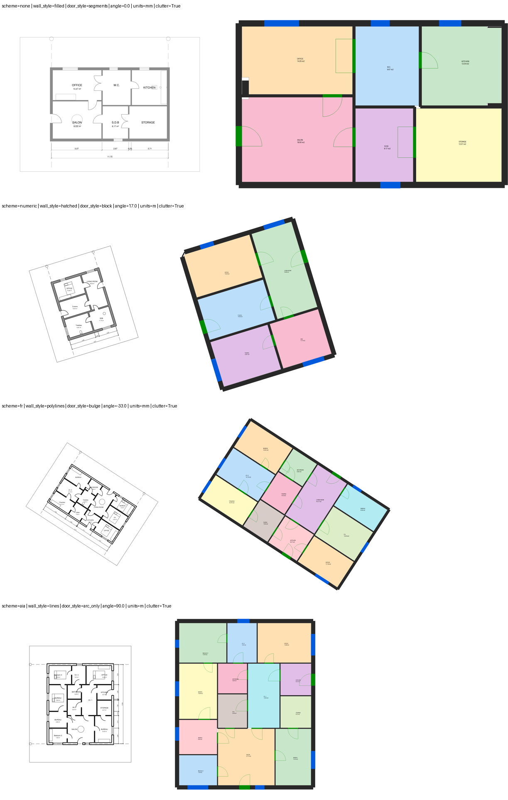

# Milestone 2: Real-world clutter, and rule drafting with a free local LLM

24 October 2026 · follows [Milestone 1](M1_vector_pipeline.md)

## In one paragraph

Plans now carry furniture, sanitary fixtures, kitchen counters, exploded hatch patterns, sheet
frames and grid axes, the things that make a naive detector see walls everywhere. On 60 randomised
cluttered plans per format, ReviewPulse still finds every room and every door connection and types
every room correctly. Requirement documents are now turned into draft rules by an open-source model
running on the laptop (no API, no cost, nothing leaves the machine): it gets the "checkable or not"
call right 93% of the time on a held-out set, and every draft still goes through a curator.

## 1. Clutter

**What was added to the test plans.** Each piece is placed inside its room, against a wall, clear
of door swings and windows:

- wardrobes and kitchen counters, 0.6 m deep;
- beds, sofas with an inner outline, and a round table;
- a bathtub, a basin and a toilet;
- exploded 45° hatch strokes inside the walls;
- a sheet frame and dashed grid axes running along the wall centrelines.

Left: input plan. Right: what ReviewPulse detected.

**What went wrong at first, and the general rules that fixed it.** Clutter first cost wall
precision (0.97) and rooms (98% found). In one rotated, hatched PDF the walls dissolved into stripes
and all but one room was lost. Each failure was traced to a mechanism, and fixed by a rule that
holds for any plan:

| Mechanism | Rule (general) |
|---|---|
| A wardrobe or counter front runs parallel to a wall at a plausible wall thickness | A wall face already bounding a wall can only take a second body if both together still make one plausible wall; parallel bodies glued side by side beyond the maximum thickness keep only the dominant-thickness piece |
| A sofa's outer and inner outlines form a ring of thin "walls" | Faces taken from two different small nested closed outlines are an object symbol |
| Exploded hatch strokes, 5–10 cm apart, pair into thin walls | Regular textures are tagged and left out: families built from real neighbours, at least four evenly spaced levels, short alike strokes on one layer |
| Isolated symbols touching nothing | Wall clusters under 3 m across, disconnected from the wall network, are objects; collinear pieces across an opening-sized gap count as connected, so piers between doors survive |
| Layer names that say nothing (`1`, `2`, `6` …) | Layer *identity* is learned. Layers whose lines are mostly wall faces are the wall layers, and wall detection re-runs on them |

Each rule went through the same loop: find the false wall, see what it was built from, write the
physical or drawing rule, re-run everything. Two of the first attempts made things worse and were
corrected before acceptance; for example, the isolated-cluster rule initially deleted piers
between doors.

**Results, 60 randomised plans per format (with clutter in ~70% of them):**

| Stage | DXF | PDF |
|---|---|---|
| Walls (length-weighted F1) | 0.9986 | 0.9985 |
| Doors (F1) | 0.999 | 0.999 |
| Windows (F1) | 0.998 | 1.000 |
| Rooms found (IoU ≥ 0.5) | 474 / 474 | 474 / 474 |
| Door connections | 551 / 551 | 551 / 551 |
| Room type from label | 100% | 100% |

Every style combination is now at room/edge F1 = 1.00:

- layer schemes: AIA, French, numeric, none;
- wall styles: outlines, polylines, hatched, fill only;
- door styles: arc + leaf, arc only, bulge, block, segments, double;
- units: m and mm.

**Planted mistakes, 72 plans per format (all 18 types, twice each):** 46/46 found on DXF and on
PDF, and the real pipeline agrees with the oracle (true) model on every plan.

## 2. Rule drafting with a free local LLM

**Setup.** [Ollama](https://ollama.com) with **Qwen2.5-7B-Instruct** (Apache-2.0, 4.7 GB) runs on
the laptop's RTX A1000. Output is constrained by a JSON schema, with temperature 0 and a fixed seed,
so the same clause always gives the same draft. `rp rules draft <document>` writes the drafts;
`rp rules review` lets a curator approve, edit or reject each one. A rule is approved only if it
passes its own self-test.

**Measuring it.** 30 regulation-style clauses (French and English, different units) were translated
by hand into gold rules. Five of them cannot be checked from a floor plan: fire rating, acoustics,
workmanship, door height, sill height. Only the odd-numbered clauses were looked at while designing
the prompt; the even-numbered ones are a held-out test.

**First design** (the model writes the whole rule): 63% right "checkable" label, 48% right
function, 8% right scope.

**Second design** (the model answers a small frame, and code builds the rule). The model answers:

- which property is measured (floor area, clear width, travel distance, fire rating …);
- for which rooms or elements;
- compared how;
- against which number, as written.

Code then:

- maps the property to the registry function;
- converts the units;
- decides checkability (a fire rating can never be checked from a plan);
- cross-checks the comparison words ("au moins", "ne dépasse pas", "at least", "shall not exceed").

| | all 30 | held-out 15 |
|---|---|---|
| Right "checkable" label | 93% | 93% |
| Right function | 76% | 75% |
| Right comparison / number | 93% / 93% | 86% / 86% |
| Right scope (rooms / elements) | 92% | 100% |
| Rules exactly right | 19 / 30 | 9 / 15 |
| Time per clause | 7.9 s | |

**What is still wrong:**

- "Written dimensions shall agree with the drawing" was read as the chain-sum check.
- "The number of exits" was read as a route check.
- A door-height clause was not refused.

These are exactly the kind of drafts the curator step exists to catch. Tuning stopped here so the
held-out number stays honest.

## Honest limits

- **Synthetic plans only.** These plans are randomised and cluttered, but they are still ours.
  Real drawings will bring new mechanisms: curved walls, several plans per sheet, text over walls,
  dimension styles we have not seen. The rules above are general, but only real plans can confirm
  that. **Next:** the public datasets (FloorPlanCAD, ResPlan) and our own gold plans.
- **Remaining wall imprecision (0.2%)** is in layer-free hatched drawings, where hatch remnants at
  wall junctions are occasionally kept.
- **The LLM gold set is small (30 clauses) and written by us.** The real regulation should be used
  to extend it.
