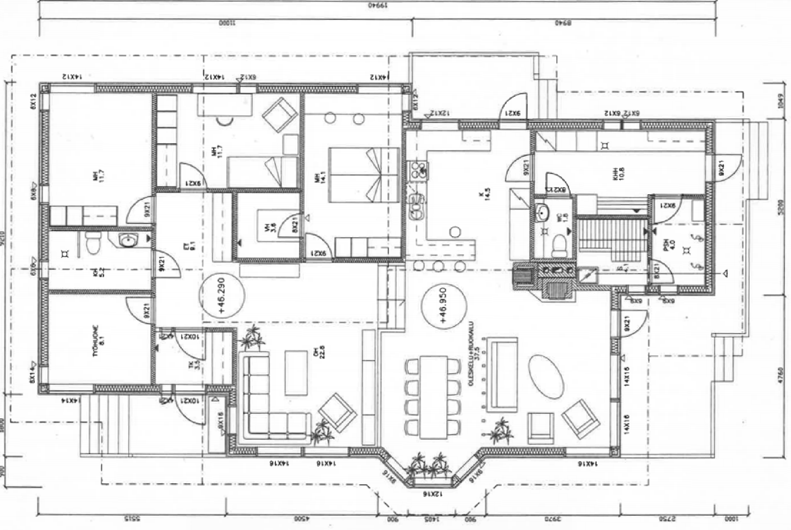
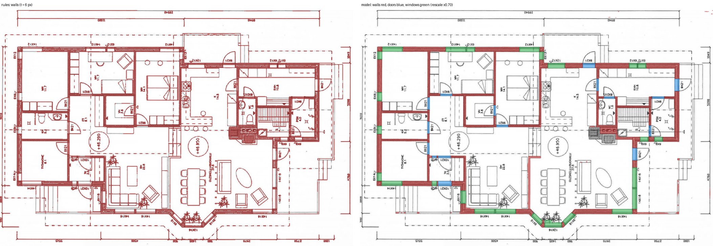
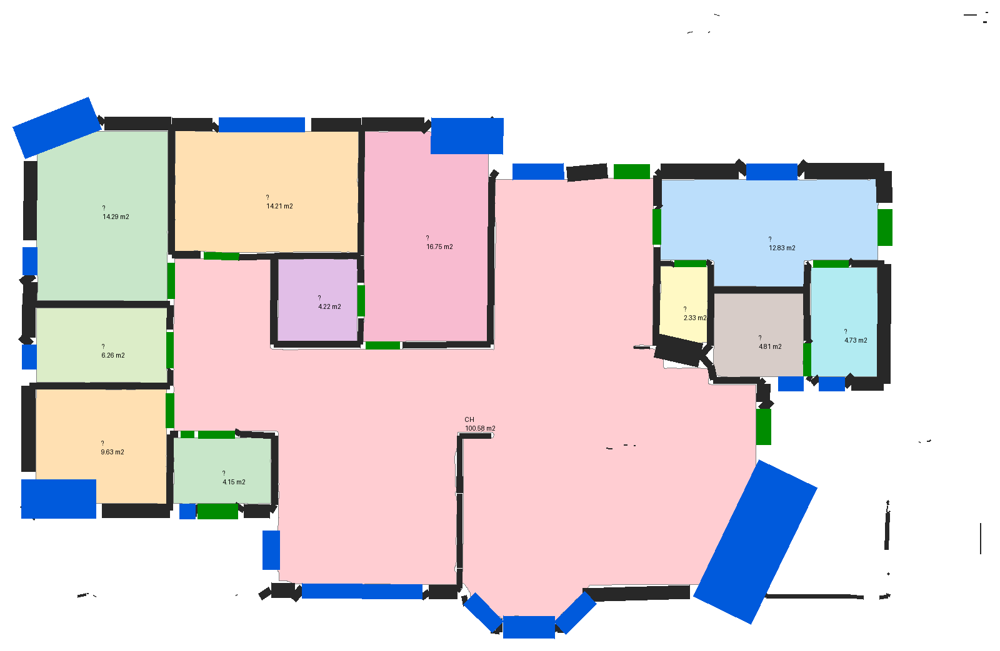
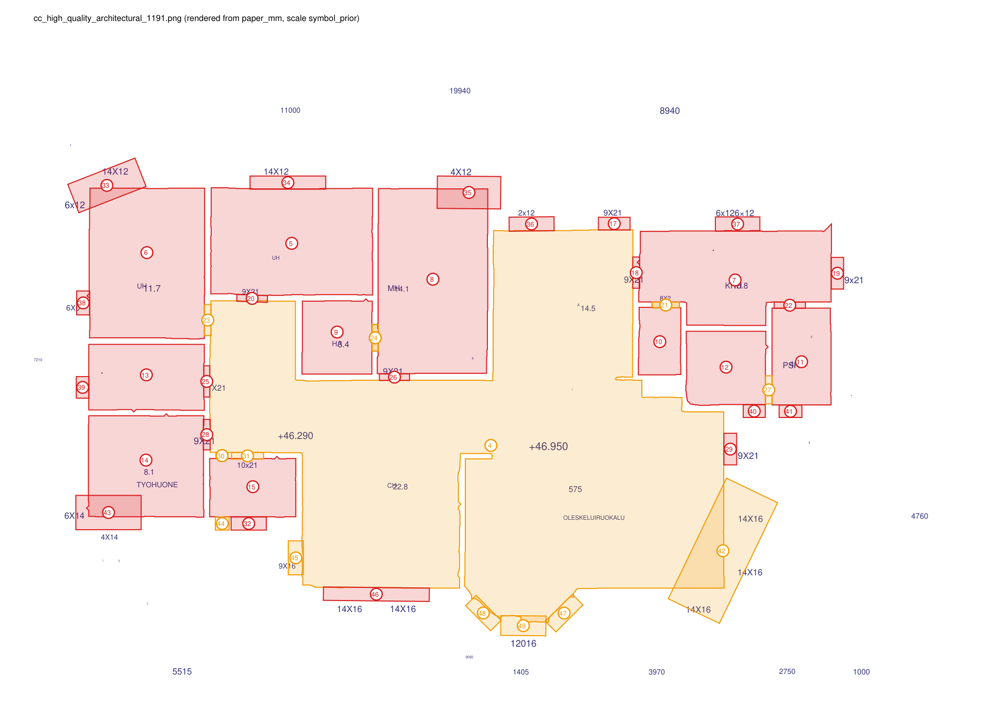
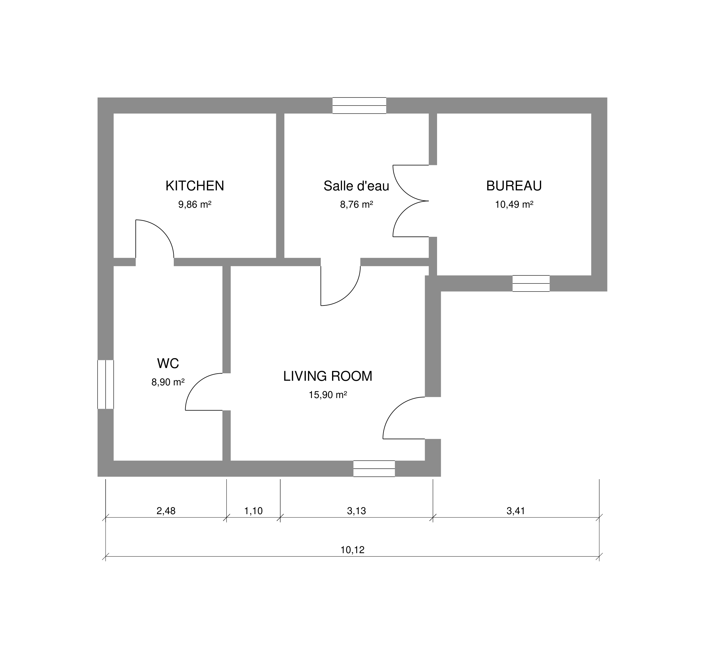
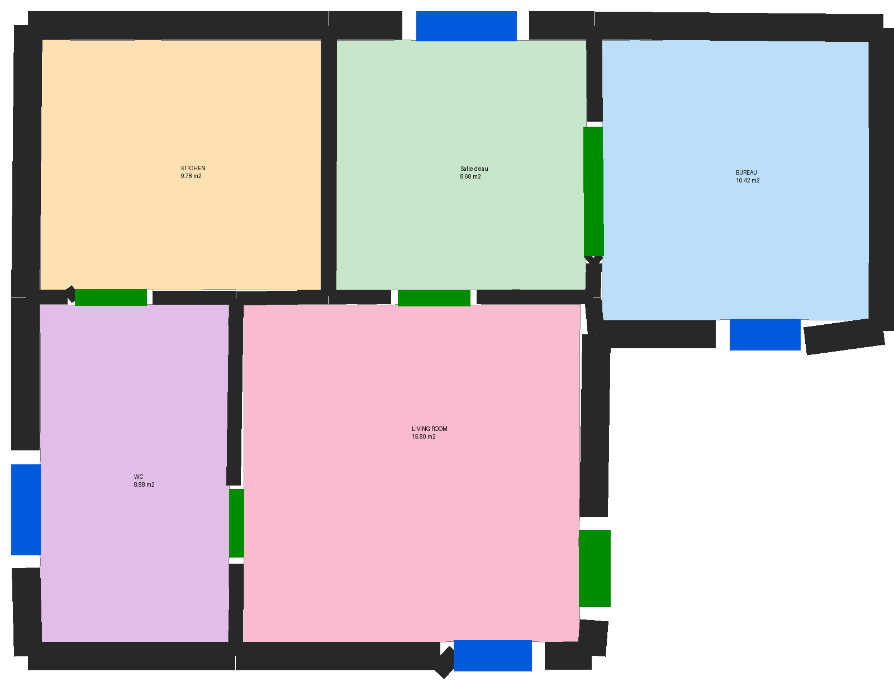
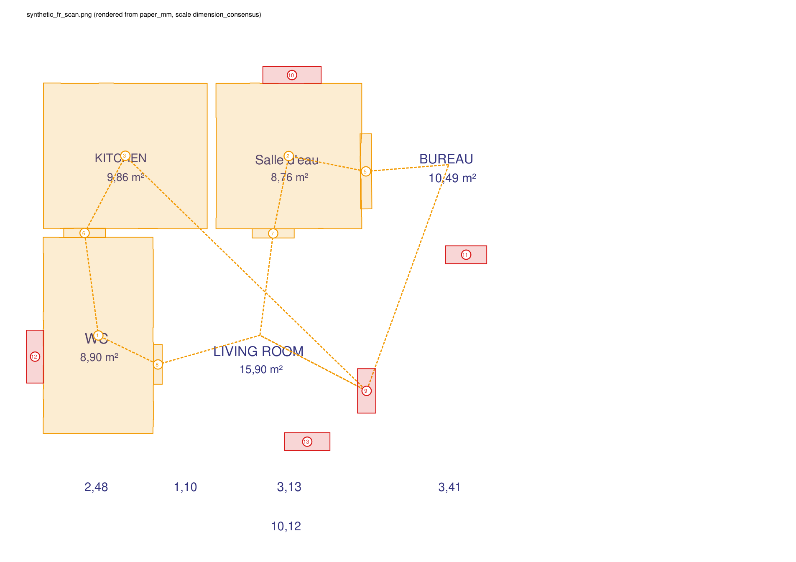

# Milestone 3: scans and photos (raster path, R13)

25 October 2026 · follows [Milestone 3b](M3b_rooms_rules.md)

## In one paragraph

`rp check plan.png` and `rp check scan.pdf` now run end to end on scanned plans. Each run
produces the same BuildingModel as a vector drawing: walls, doors, windows, rooms with door
edges, and OCR text. A U-Net trained on CubiCasa5K finds walls, doors and windows. PaddleOCR reads
labels and dimensions. Rooms come from the existing R10 detector.

Measured on 100 CubiCasa5K test scans the model never saw, through the pipeline's own entry point:

| | walls F1 | doors F1 | windows F1 | rooms F1 |
|---|---|---|---|---|
| model | 0.95 | 0.85 | 0.81 | 0.90 |
| rule baseline | 0.69 | none | none | 0.34 |

On a synthetic French scan the whole chain reads the drawing's own dimension chain and recovers
1:50. All five room areas then come out within 2% of the truth.

A scan is never better than tier T3 or T2, so metric rules on scans give at most WARNING.

## 1. What a scan goes through



*CubiCasa5K test plan 1191 (`F1_scaled.png`, 2319 × 1555 px, Finnish labels), checked with `rp check`.*

1. **Page preparation.** The page is rendered (PDF) or loaded (image). Then:
   - it is deskewed;
   - it is binarised with Sauvola;
   - a page affine maps pixels to sheet millimetres.
2. **OCR** (PaddleOCR PP-OCRv6, CPU). The page is cut into 1,536 px tiles, and each tile is read
   at 0/90/270/180°. Duplicate reads are merged, keeping the read from the pass in which the text
   was upright. Texts are classified as room label, area, dimension or tag by the existing
   classifier.
3. **Walls, doors, windows** come from a U-Net with a ResNet34 encoder, run on overlapping tiles.
   First the page is rescaled so its walls are as thick as in training (14 px):
   - the thickness is measured on the model's own wall mask, from two downscaled probes (decision A14);
   - ink-based thickness is not used: it measured outlines, giving 6.5 px for 18 px walls.
4. **Vectorisation.** Wall skeletons become centreline elements with a measured thickness. Door
   and window blobs become oriented rectangles with a width and a midpoint.
5. **Scale.** R7 dimension consensus runs on the OCR dimensions plus LSD line segments. Without
   it, a prior is used: the dominant wall is taken as 0.20 m (`symbol_prior`, confidence 0.4, T3).
6. **Rooms.** R10 runs with the predicted walls, doors and windows as barrier, then rules and
   reports run unchanged.



*Left: the rule baseline's walls (red). Right: the model (walls red, doors blue, windows green),
fed at ×0.70. Furniture, stairs, text and dimension lines stay out of the model's walls; the rule
baseline keeps most of them.*



*The BuildingModel R10 built from the model's masks (`rooms_0.png`). This renderer draws doors
green and windows blue. Areas use the wall-thickness prior: the bedroom labelled "MH 11.7" measures
14.3 m², which is about the accuracy a 0.20 m wall prior allows. That is why the scale is T3.*



*First page of `report.pdf`, with OCR text placed in sheet space. Window sizes such as "14X12" and
door sizes such as "9X21" sit beside their openings.*

## 2. Measured on CubiCasa5K test: `rp eval raster --n 100 --method all`

These are 100 scans of the test split, sampled evenly, scored against the dataset's SVG.

**How it is scored:**
- walls: pixel precision and recall within 3 px, and IoU;
- doors and windows: one-to-one instance matching at IoU 0.5;
- rooms: R10's rooms against the SVG spaces at IoU 0.5, with open-plan neighbours merged (A22)
  and terraces not scored.

The oracle row feeds R10 the true walls, doors and windows, so it separates R10's own errors from
segmentation errors.

| method | walls P / R / F1 (3 px) | walls IoU | doors F1 @0.5 | windows F1 @0.5 | rooms P / R / F1 @0.5 |
|---|---|---|---|---|---|
| rules (baseline) | 0.573 / 0.880 / 0.694 | 0.406 | – | – | 0.454 / 0.268 / 0.337 |
| model (input already at training size) | 0.930 / 0.979 / 0.954 | 0.798 | 0.837 | 0.796 | 0.911 / 0.838 / 0.873 |
| fusion (model + unmatched rule walls) | 0.735 / 0.983 / 0.841 | 0.639 | 0.837 | 0.796 | 0.840 / 0.799 / 0.819 |
| **model_scan** (full-resolution scan, pipeline entry `predict_refined`) | **0.930 / 0.974 / 0.952** | 0.792 | **0.850** | **0.814** | **0.921 / 0.880 / 0.900** |
| oracle barrier (true masks) | | | | | 0.965 / 0.985 / 0.974 |

Doors and windows at IoU 0.3: P/R 0.84/0.93 for doors and 0.85/0.87 for windows (`model_scan`).
Reports: `reports/2026-10-25_raster_all.md` and `reports/2026-10-25_raster_model_scan.md`.

**What the numbers say:**
- **The model is the raster path.** It removes most of the rule baseline's false walls:
  furniture, text, stairs and dimension lines.
- **Fusion is off by default (A18).** It added 0.4 points of wall recall and cost 19 points of
  precision.
- **The rule baseline fails on hollow walls.** Many CubiCasa scans draw walls as two lines with no
  fill. We looked for a rule that measures the gap between the two lines and found nothing
  reliable: background-gap histograms have no peak. So no rule was added, and the rule baseline
  stays a fallback for machines without the model.
- **Most remaining room loss is segmentation.** R10 reaches F1 0.974 on true masks and 0.900 on
  predicted ones. The worst plans have walls missing across open-plan rooms, or a door the model
  read as wall.

**Training** (`scripts/train_raster_seg.py --epochs 34`, seed 7):
- data: 4,200 CubiCasa train scans at longest side 1,024 px, 512 px crops with scan-like
  augmentation;
- loss: cross-entropy plus Dice;
- time: 98 min on the laptop's RTX A1000 6 GB;
- best validation IoU (400 scans): wall 0.822, door 0.717, window 0.815.

CubiCasa5K is CC BY-NC 4.0, so this model may be used only for non-commercial work.

## 3. OCR choice: spike S-D (`scripts/spike_ocr.py`, `reports/2026-10-25_ocr_spike_paddle_vs_easyocr.md`)

| | PaddleOCR (CPU) | EasyOCR (GPU) |
|---|---|---|
| CER, 25 hand-transcribed crops | **0.120** (18 exact) | 0.612 (9 exact) |
| detection P / R / F1, 30 test pages (1,129 FP-TXT boxes, IoU 0.3) | 0.83 / **0.78** / **0.81** | 0.88 / 0.20 / 0.33 |
| time per page | ~2 min (4 rotations, CPU shared with training) | 3.5 s |

**Ground truth for the spike:**
- **Detection.** FP-TXT (Schönfelder et al. 2023) annotates text boxes on CubiCasa scans. Its
  replication rule was re-implemented rather than run: 945 of its 1,000 images map with matching
  sizes.
- **CVC-FP.** FP-TXT's second dataset can no longer be downloaded, so CVC-FP is not measured.
- **Recognition.** FP-TXT has no transcriptions, so 36 random boxes were cropped and transcribed by
  eye, correcting the reading direction. The 11 that were illegible or ambiguous were excluded, and
  are listed in `reports/ocr_spike/gt_notes.json`.

**Remaining Paddle errors:**
- decimal comma read as a point ("1797.5");
- "3h" read as "34";
- one upside-down label read in the wrong order ("HO").

Reading only at 0° costs 4 points of CER (0.160 against 0.120), so all four rotations are kept.

## 4. End to end on a scan in the target languages



The scan is a synthetic plan from the generator, rendered to PNG at 200 dpi:
- filled grey walls, with exterior walls of 0.33 m and partitions of 0.17 m;
- French and English labels, stated areas, and a dimension chain.

`rp check` on it:

- **OCR:** read all 15 texts correctly (5 room labels, 5 areas, 5 dimensions).
- **Scale:** R7 paired 4 of the 5 dimensions with their dimension lines and recovered **1:50**
  (`dimension_consensus`, 3 inliers). The truth is 1:50. Confidence was 0.75, below the 0.8 needed
  for T2, so the plan stays **T3**.
- **Openings:** 5 of 5 doors and 4 of 4 windows.
- **Rooms:** 5 of 5, each labelled. Areas are within 2% of the truth:

  | room | true m² | measured m² |
  |---|---|---|
  | Salle d'eau | 8.76 | 8.68 |
  | Kitchen | 9.86 | 9.78 |
  | Bureau | 10.49 | 10.42 |
  | Living room | 15.90 | 15.80 |
  | WC | 8.90 | 8.88 |
- **Findings:** the topology rules give WARNING with "[verify connections]", because elements from
  a scan are unconfirmed. Example: "KITCHEN can only reach an exit through WC".





**Two raster-specific fixes made this work (A15, A19):**
- **Text angle.** OCR engines also read boxes they turned internally, so a horizontal dimension
  could be stored as vertical. Reads from the pass where the box was upright now win.
- **Line width.** LSD's support width is not a stroke width, so raster line primitives no longer
  claim one. R7's PDF thin-line filter had been dropping every dimension line.

## 5. Honest limits

- **Tiers.** A scan is T3 unless R7 reaches confidence 0.8 (T2). It is never T1. Metric findings
  on scans are therefore at most WARNING.
- **Presence-rule verdicts on scans.** On the CubiCasa scan, P-1 (room has no label) and P-5
  (opening has no tag) return FAIL at T3. The labels exist, but in Finnish, outside the French and
  English room vocabulary. The plans also carry no opening tags. Whether a presence rule may FAIL on
  OCR'd input is an engine-policy question; it is passed to the rules stream. P-4 (title block) is
  correct: these scans have none.
- **Scale prior.** Without readable dimensions, areas rest on a "dominant wall = 0.20 m" prior.
  The CubiCasa bedroom came out 20% large. The page carries the warning "metric rules give at most
  WARNING".
- **OCR.**
  - It takes about 2 min per page on CPU.
  - Some vertical labels survive dedupe twice, overlapping ("MH" and "H4.1").
  - A decimal comma is sometimes read as a point.
- **Odd openings.** A door or window blob that merges with stairs or terrace lines becomes an
  oversized rotated rectangle (item 42 on the report).
- **Domain.** The model is trained on Finnish residential scans (CubiCasa5K) and rendered
  synthetic plans were never in training. It generalised to the synthetic French scan (section 4),
  but large office plans, coloured CAD prints and phone photos at a slant are untested.
- **Licence.** CubiCasa5K is CC BY-NC 4.0, and so is the trained model: non-commercial use only.

## 6. Reproduce

```
pip install -e ".[raster]"      # plus CUDA torch and paddlepaddle==3.2.0, see README
python scripts/prepare_cubicasa_seg.py
python scripts/train_raster_seg.py --epochs 34          # -> data/models/raster_seg/
rp eval raster --n 100 --method all                     # rules, model, fusion, model_scan, oracle
python scripts/spike_ocr.py cer ; python scripts/spike_ocr.py detect --n 30
python scripts/raster_figures.py --plan high_quality_architectural/1191 --also runs/rtest/synthetic_fr_scan.png
pytest -q tests/raster                                  # 1 model test is marked slow
```

The synthetic scan comes from `random_plan(seed=11, png=True, scheme="aia", wall_style="filled",
door_style="arc_leaf", units="m", clutter=False)`.

Decisions A14–A19 are in [DECISIONS.md](../DECISIONS.md).
