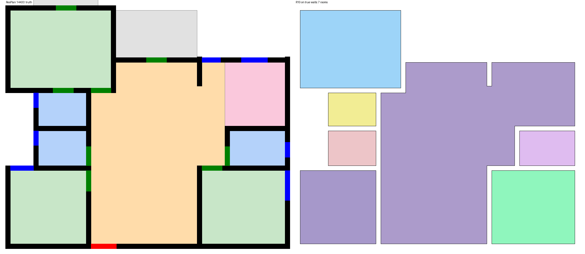
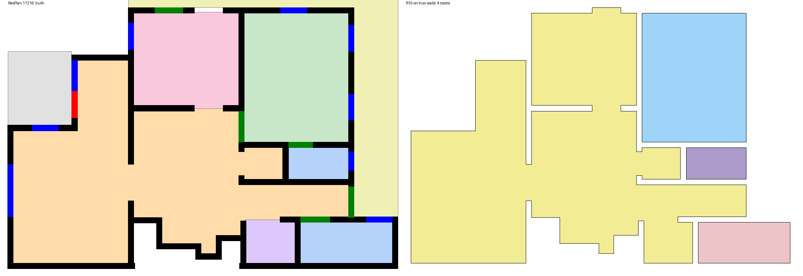
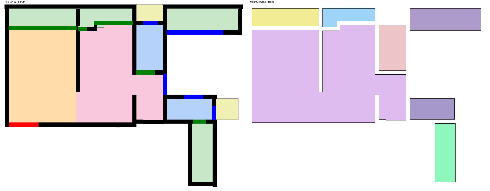
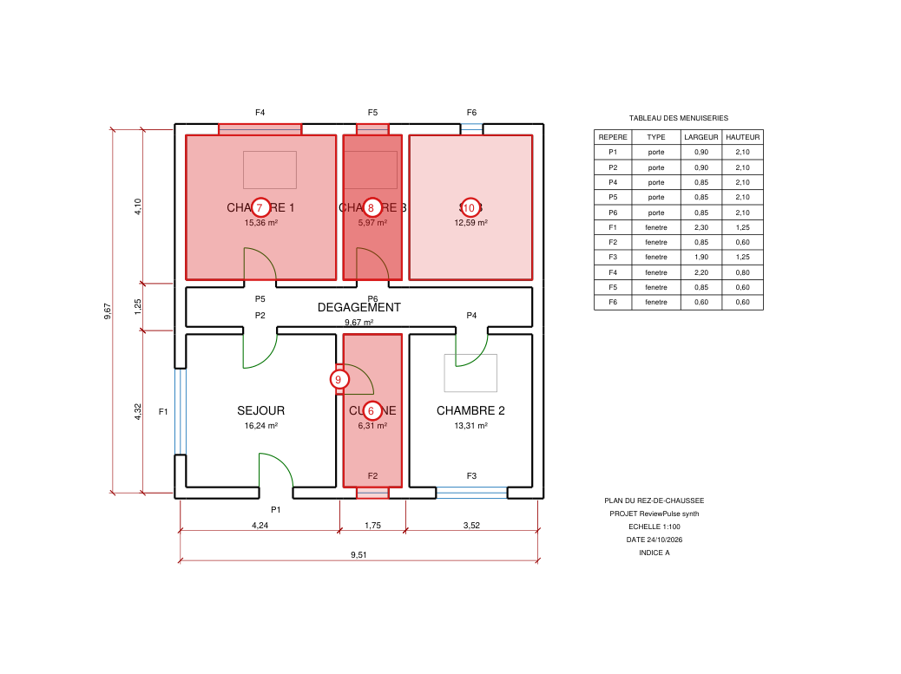

# Milestone 3b: rooms at scale, a 25-rule pack, regression snapshots

24–25 October 2026 · follows [Milestone 2](M2_clutter_and_local_llm.md)

## In one paragraph

Room detection (R10) was measured on all 1,632 ResPlan test plans, which are real residential
layouts drawn by people. Doors, windows and walls come from the dataset itself, so this tests R10
alone. R10 finds 99.4% of the true spaces and 99.4% of the door connections. Two general fixes
lifted every metric:
- the scale is read from the doors when the metadata is unreliable;
- leaks in the building envelope are sealed.

The starter rule pack now has 25 approved rules. Every rule passes on a clean plan and fires on at
least one planted error. Ten fixed plans are stored as regression snapshots, so any change in
perception or in a rule shows up as a test failure that names exactly what moved.

## 1. Rooms on ResPlan: `rp eval rooms --dataset resplan --n 1632`

**How it is scored.** The dataset's own walls, doors and windows form the barrier. R10 then has to:
- find the enclosed spaces;
- connect the spaces through the doors;
- say which doors lead outside.

The truth needs two corrections before it can be scored fairly:
- **Open-plan rooms.** ResPlan labels a kitchen and a living room separately even when no wall
  separates them. A system that sees one space there is not wrong, so true rooms that share an
  open boundary are merged into one truth space before matching.
- **Door edges.** Each door's truth edge links the spaces just beyond its two faces (or "outside").
  This is found by probing beyond the door, not from the room labels.

Balconies and terraces are outdoor spaces. They are counted but not scored (2,033 of them).

| metric (1,632 plans) | before | after |
|---|---|---|
| spaces P / R / F1 (IoU ≥ 0.5) | 0.9941 / 0.9918 / 0.9929 | **0.9955 / 0.9934 / 0.9944** (9,718 of 9,783) |
| door edges P / R / F1 | 0.9918 / 0.9893 / 0.9906 | **0.9939 / 0.9932 / 0.9936** (10,971 of 11,046) |
| doors labelled EXIT vs true front doors | 3,996 vs 1,607 | 3,882 vs 1,629 |

**Fix 1: scale from the doors (A20).** ResPlan's area metadata gives absurd scales on some plans
(from 0.009 to 0.75 m per unit). The scale is now taken as 0.85 m divided by the median door width.
The area-based scale is used only when a plan has no doors. Most of the worst plans recovered.

**Fix 2: sealing envelope leaks (A21).** Some plans draw a gap in the outer wall, such as a missing
window or a sliding door drawn as a thin strip. The outside then flows into the building and a
whole wing disappears. R10 now does the following:
1. Erodes the exterior by 0.75 m.
2. Keeps as "true outside" only the parts still connected to the sheet border.
3. Turns any region that the erosion cut off into an interior space, provided its mouth is at most
   12% of its perimeter.

This closes leaks narrower than 1.5 m without closing real courtyards, whose mouths are wide.
Every plan that is sealed this way gets a warning in its report.

Left: truth. Right: what R10 found.



*Plan 14433: every space and every door connection found.*



*Plan 11216: a gap in the envelope used to flood the living area with outside. After sealing, the
large open space is back.*



*Plan 8271 is one of the remaining worst plans (F1 0.77). Sliding doors are drawn as long strips,
and the truth labelling of the open plan is ambiguous.*

**Exits, stated honestly.** R10 labels 3,882 doors as exits, against 1,629 true front doors. The
extra exits are almost all balcony doors. Without a "balcony" or "terrace" label the geometry
cannot tell a balcony from the street. When such a label exists outside the door, the door is
classed EXTERIOR and not EXIT (test `tests/golden/test_exits.py`). This is a known limitation, not a
tuning target. Exit rules (C-C1, C-T1) should be read with it in mind on unlabelled plans.

## 2. Rule pack: 25 approved rules, all self-tested

`rp rules test` runs each rule on a clean plan, where it must stay silent, and on every planted error
that targets it, where it must fire. All 25 rules come out **ok** (full table:
[reports/2026-10-25_rule_tests.md](../../reports/2026-10-25_rule_tests.md)). The M1/M2 notes said
the pack had 22 rules; it actually had 21.

New rules. Their thresholds are in [requirements_example.md](../requirements_example.md):

| rule | article | check | planted error |
|---|---|---|---|
| C-D5 | 6.5 | kitchen area ≥ 7.00 m² | `metric_kitchen_small` |
| C-V2 | 7.2 | each bedroom has an exterior window ≥ 0.60 m wide and ≥ 1.00 m high | `metric_escape_window`, `metric_window_small` |
| P-5 | 9 i) | every door and window carries a tag | `comp_door_untagged` |
| P-6 | 2.1 | every enclosed room has a door or opening | `topo_isolated_room` |

Rules that had no failing fixture before now have one: C-D3W (`metric_bedroom_narrow`), C-D3L
(`metric_living_small`, `metric_bedroom_narrow`) and C-T5 (`metric_travel_far`).

**Window heights come from the schedule only (A23).** A plan view does not show how tall a window
is. If any window in a room has no scheduled height, C-V2 returns NOT_EVALUATED. It never guesses.

**A side effect found by the self-test.** The plan generator first sized windows up to 3.3 m wide.
Openings wider than R9's 3.0 m limit are not seen as openings, so those rooms leaked. Generated
windows are now capped at 2.9 m. Real windows wider than 3 m remain a limitation of R9 (see
Unresolved).

**The new rules in the annotated report.** This is a generated plan with four planted errors:
- an escape window too low (F4 is 0.80 m high);
- an untagged door;
- a bathroom with no door;
- a small kitchen.

ReviewPulse found all four, plus their consequences:
- bedroom 3 and the kitchen fail on area and width;
- three rooms fail on light;
- F5 fails as an escape window.

The other 91 checks passed.



```
C-D3  FAIL  CHAMBRE 3 measures 5.97 m²; >= 9.00 m² is required.
C-D3W FAIL  CHAMBRE 3 narrows to 1.55 m; >= 2.20 m is required.
C-D5  FAIL  CUISINE measures 6.31 m²; >= 7.00 m² is required.
C-V2  FAIL  CHAMBRE 1: largest window F4: 2.20 x 0.80 m; >= 0.60 x 1.00 m is required to escape.
C-V2  FAIL  CHAMBRE 3: largest window F5: 0.85 x 0.60 m; >= 0.60 x 1.00 m is required to escape.
P-5   FAIL  door 13cbc3 has no tag.
P-6   FAIL  SDB has 0 door(s) or opening(s); >= 1 required.
(+ C-V1 light-ratio failures for CHAMBRE 1, CHAMBRE 3, CUISINE)
```

## 3. End to end on all planted errors: `rp eval findings`, `rp eval findings_pdf`

100 generated plans per format carry 72 planted errors, spread over all 25 rules and all error types
including the new ones. The real pipeline (which reads the drawing) and the oracle model (true
geometry) are both scored.

| format | planted | found (real) | found (oracle) | perception disagreements |
|---|---|---|---|---|
| DXF | 72 | **72 (1.000)** | 72 | 0 |
| PDF | 72 | **72 (1.000)** | 72 | 0 |

The first run found 71/72. The miss was C-D3L, and it was also missed on the oracle, so the problem
was not in perception. The generator had planted a "small living room" with a fixed width. On plans
where the living room was deep, that room still measured 14.1 m², so it was not actually too small.
The generator now derives the width from the drawn depth (12.5 m² net), and the eval is clean. This
is why the eval scores the oracle model too: it separates bad fixtures and rules from perception
errors.

Reports: [reports/2026-10-25_findings_rules.md](../../reports/2026-10-25_findings_rules.md),
[reports/2026-10-25_findings_pdf_rules.md](../../reports/2026-10-25_findings_pdf_rules.md).

## 4. Regression snapshots (T4)

`tests/golden/test_snapshots.py` stores summaries of 10 fixed plans:
- 6 generated plans: clean DXF and PDF, bathroom route, narrow door, dimension chain, page rotated 90°;
- 4 randomised plans covering every wall, door and labelling style, at angles of 0°, 17°, −33° and 90°.

Each summary holds:
- element counts per class;
- room areas;
- the number of room-graph edges;
- the scale;
- the set of (rule, verdict) pairs.

Counts and verdicts must match exactly. Areas may move by max(2%, 0.2 m²) and the scale by 0.5%. When
a change is intended, run `pytest tests/golden/test_snapshots.py --snapshot-update` and review the
JSON diff in the pull request.

## 4b. Report flows

New tests in `tests/golden/test_reports.py` cover three flows:
- **Triage.** `rp check <run> --dismiss <id>:<reason> --confirm <element>` is written to
  `triage.json` with an audit log. The next run applies it again, and the dismissal shows in the
  HTML and the CSV.
- **Rotated sheets.** On a PDF page rotated 90°, the red FAIL marker lands on its evidence, and the
  HTML stays self-contained.
- **Multi-sheet PDFs.** Each page becomes its own building model with its own findings. The
  annotated PDF has one page per sheet plus the summary, and the HTML has one section per sheet.

## Unresolved

- R9 (`perception/openings.py`, vector stream) has a 3.0 m maximum gap. Windows wider than 3 m are
  missed, and the room behind them leaks.
- Balcony doors with no label are counted as exits (see section 1).
- The remaining worst ResPlan plans are caused by sliding doors drawn as strips, very small
  spaces, and ambiguous open-plan truth.
