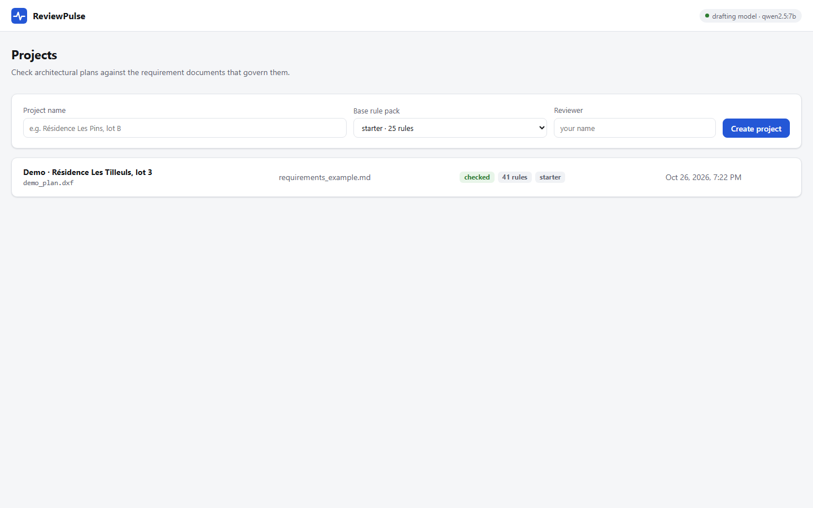
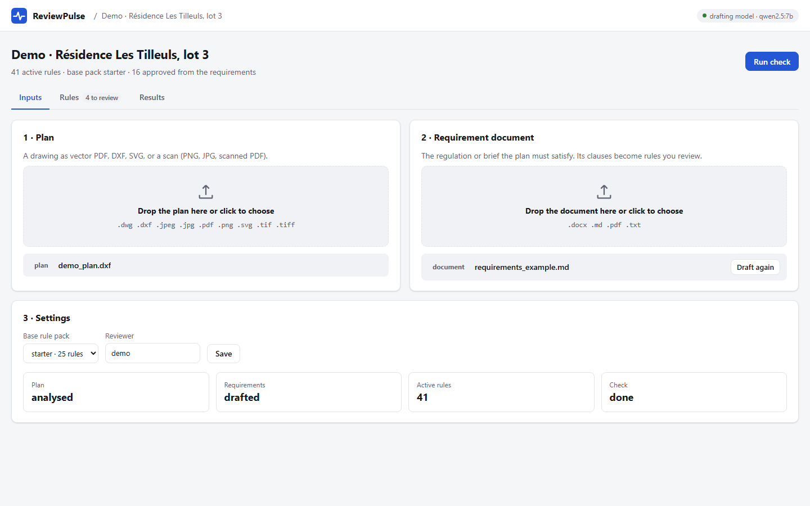
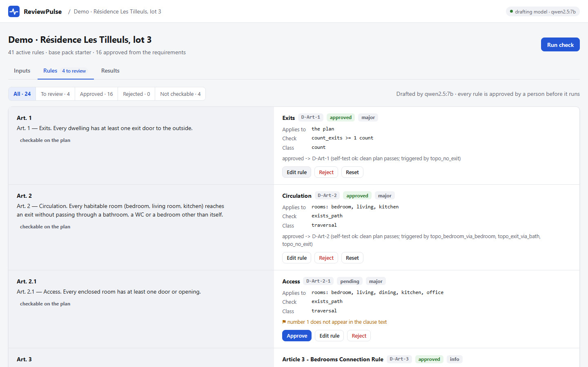
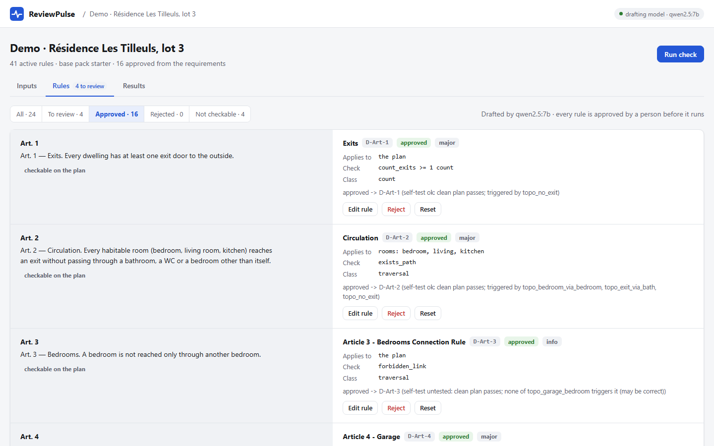
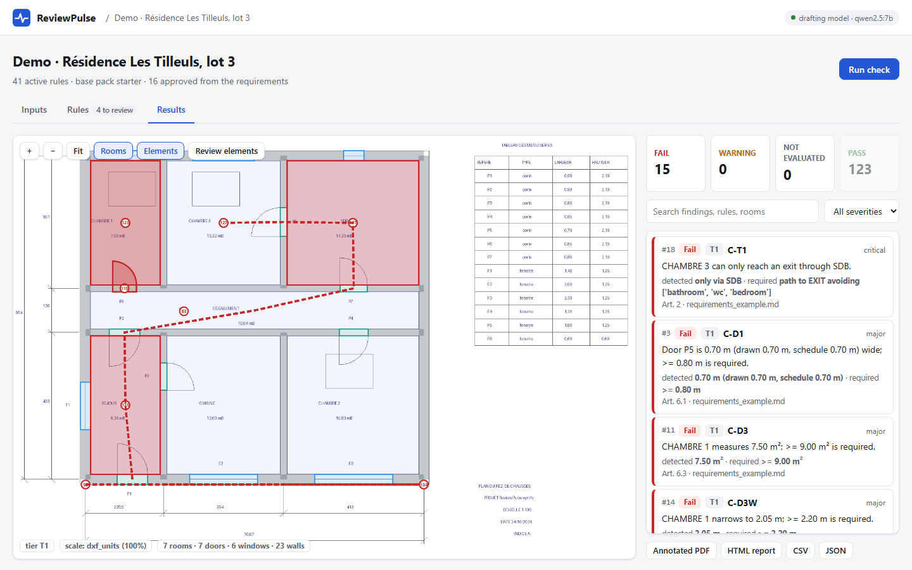
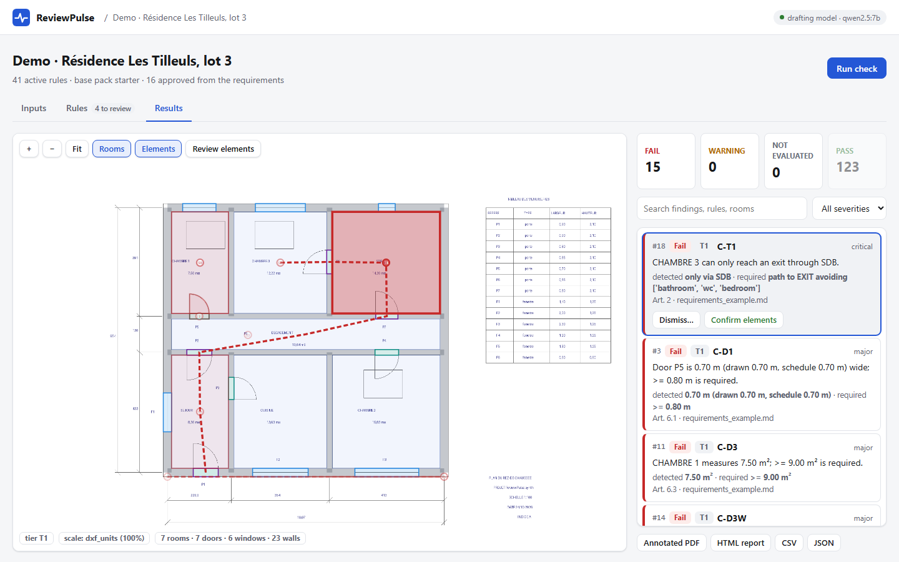
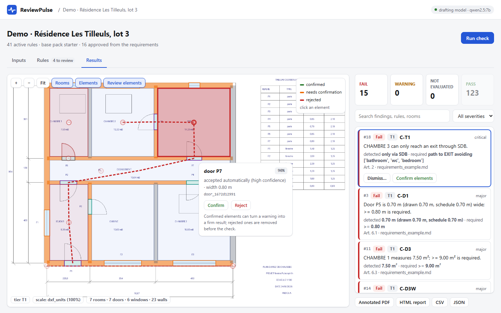
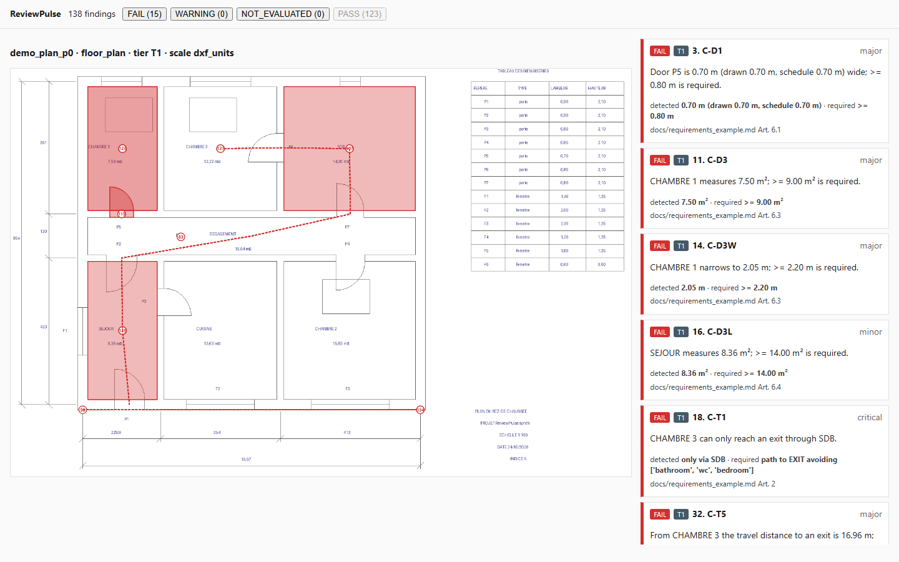

# Milestone 4: the product app

26 October 2026 · follows [Milestone 3](M3_raster_path.md)

## In one paragraph

ReviewPulse now runs as a web product as well as a command-line tool. `rp serve`, or
`docker compose up`, starts a web service with a browser UI. A reviewer creates a project, drops
in a plan and the requirement document, and reviews the rules the local model drafted from that
document. They then read the results on the plan itself. Every step reuses the existing pipeline,
with no second copy of the logic.

Measured through the HTTP API on a generated plan with 5 planted errors and the example
requirement document:

| Step | Time | Outcome |
|---|---|---|
| Plan analysis + check with the base pack | 5–17 s | 36 elements, 7 rooms, tier T1 |
| Requirement drafting (qwen2.5:7b, local) | 221–285 s | 24 clauses, 20 rules drafted |
| Rules approved | – | 16 approved; the 4 flagged drafts were left for a person |
| Check with 41 rules (25 starter + 16 drafted) | 1–2 s | 15 FAIL, 123 PASS |
| **Planted errors found** | | **5 / 5** |

## 1. The flow

### Projects



A project has:
- a name;
- a base rule pack (or none);
- a reviewer name, which is stored on every rule they approve.

Projects live on disk as plain JSON and YAML under one folder each. The CLI can open them too:
`rp check data/app/projects/<id>/run`.

### Inputs



**Plan:** PDF, DXF, DWG, SVG, or a PNG/JPG/TIFF scan. Uploading it starts a background job that
runs `inspect → extract → build → check` from `pipeline.py` and reports progress.

**Requirement document:** PDF, DOCX, Markdown or text. Uploading it starts the clause splitter
(I3) and then the drafting model (I4), clause by clause, with progress shown as
"drafting clause 17 of 24".

If the model is not reachable, drafting degrades instead of failing:
- the clauses are still listed;
- the base pack still applies;
- the page says how to start the model.

### Rule review



Each clause sits next to the rule drafted from it: what it applies to, the check, and the
drafter's flags. For example, "number 1 does not appear in the clause text" flags a number the
model introduced.

The reviewer can approve, edit (YAML), reject or reset each rule. Approval runs the rule's
self-test (I5): a metric rule must pass a plan just inside its limit and fail one just outside.
A rule that fails its self-test is refused, with the reason. Approved rules form the project's own
pack, layered on the base pack.



### Results



**Plan viewer:** the plan with every finding drawn on it, using the same evidence geometry as the
PDF report. Room tints and detected elements are layers you can switch on and off. Pan with drag,
zoom with the wheel.

**Findings list:**
- a summary that also filters (FAIL / WARNING / NOT EVALUATED / PASS);
- severity and text filters;
- each finding shows the measured and required values and the clause it comes from.

Clicking a finding zooms to it, dims the others and highlights its subject elements:



### Confirming and rejecting elements



"Review elements" colours each detected element by status:
- **accepted automatically:** confidence above the calibrated threshold;
- **needs confirmation;**
- **confirmed** or **rejected** by the reviewer.

Clicking an element lets the reviewer confirm or reject it.
- A confirmed element counts as user-confirmed in the verdict policy, so a finding on T2/T3
  evidence can become a firm FAIL.
- A rejected element leaves the model before the check, together with the room connections that
  pass through it.

Findings can also be dismissed with a reason and restored later. Every change is written to
`triage.json` with a timestamp and re-runs the check in the background.

### Reports

The annotated PDF and the HTML report open in the browser; CSV and JSON download.



## 2. How it is built

```
src/reviewpulse/app/
  store.py     projects on disk (inputs/, run/, drafts/, pack/, jobs/); safe file names
  jobs.py      thread-pool job runner, one job at a time per project, records on disk,
               interrupted jobs marked failed at start-up
  service.py   analyse / draft / review / check / triage / viewer data: thin calls into
               pipeline.py, rules/ and report/
  api.py       FastAPI: 23 API endpoints + the page, OpenAPI docs at /docs
  static/      single page (HTML, CSS, JS, no build step), light and dark themes
```

The viewer reads `view.json`, which is written after each check. It holds the plan image as PNG
(the same backdrop as the HTML report) and every room, element and finding already converted to
image pixels. The conversion is taken from the report's own sheet-to-pixel function. The browser
therefore draws overlays without knowing about sheet coordinates, and vector and raster sheets
look the same.

Changes to shared code, all general:

| Change | Where | Why |
|---|---|---|
| `check()` takes a list of packs; a later pack overrides the same rule id | `pipeline.py` | project pack layered on the base pack |
| `triage.json` gains `rejected`; `apply_rejection` drops those elements and their edges before the check; `unset` / `restore` actions | `pipeline.py` | reviewer corrections |
| `draft_document(progress=...)` callback | `rules/draft.py` | job progress |
| `.docx` requirement documents (paragraphs and table rows in order) | `rules/clauses.py` | common input format |
| Rule ids collapse repeated dashes (`D-Art-6-1`, not `D-Art--6-1`) | `rules/draft.py` | readable ids |
| **Self-test probe outside the tolerance band** | `rules/review.py` | see below |
| A threshold rule without a comparison or value is refused, with the reason | `rules/review.py`, `rules/draft.py` | it used to crash in the engine (`float(None)`) |
| Room-metric rules applied to elements are refused | `rules/review.py` | was only caught by accident |

**A self-test bug found by the product flow.** The metric self-test probed at ±5% of the limit.
5% is exactly the area tolerance band of the verdict policy (`AREA_TOL_REL`), so the "too small"
probe read as WARNING and every correct area rule failed its self-test. No area rule could be
approved from a requirement document. The probe now sits at twice the policy tolerance. The unit
test that expected a deliberately wrong rule to be refused had been passing only because of this
bug: it applied a room-area rule to windows. That case is now refused for the right reason, and
both cases have tests.

## 3. Running it

```
pip install -e ".[app]"        # fastapi, uvicorn, python-multipart, jinja2, httpx, python-docx
rp serve                       # http://127.0.0.1:8000, projects in data/app
docker compose up --build      # app + Ollama (qwen2.5:7b pulled on first start)
python scripts/demo.py         # the measured flow above, through the HTTP API
python scripts/app_screenshots.py --url ... --project ...   # these figures (Playwright)
```

Environment:
- `REVIEWPULSE_LLM`: `ollama` (default), `claude` or `none`;
- `REVIEWPULSE_LLM_MODEL`: the model name;
- `OLLAMA_HOST`: where Ollama runs.

The Docker image is CPU-only. Building with `--build-arg WITH_RASTER=1` adds scan support (torch
CPU, PaddleOCR).

## 4. Tests

`tests/app/test_api.py` runs the whole flow through FastAPI's TestClient, with a fake drafting
model so Ollama is not needed:
- upload a plan with planted errors, then check: C-D1 and P-1 fail;
- `view.json` geometry lies inside the image; reports download;
- upload the requirements: 2 drafted rules;
- approve an edited rule: its findings appear; reject it: they disappear;
- reject the narrow door: its width finding disappears and the element shows as rejected;
- undo; dismiss with a reason;
- error cases: unsupported file type, unknown project, path-like ids, a check before any plan,
  an unknown pack, a download outside the allowed list;
- drafting with the model offline;
- jobs interrupted by a restart are marked failed.

## 5. Open

- **Not tested with Docker here.** The Dockerfile and compose file are written, but no Docker
  engine was available on this machine to build them.
- **No accounts, no access control.** One reviewer name per project is all there is. The service
  is meant for a trusted network until login is added.
- **Demo auto-approval.** `scripts/demo.py` approves drafts that carry no flag. In the product, a
  person approves every rule.
- **Untyped rooms.** An unlabelled room has no type, so the habitable-room rules (C-T1 and the
  drafted D-Art-2) skip it rather than return NOT_EVALUATED. With two planted errors on the same
  room, the route error was not reported. Whether an untyped room should give NOT_EVALUATED for
  type-scoped rules is an engine-policy question.
- **Long drafting.** Drafting a 24-clause document takes about 4–5 minutes on the local 7B model.
  The job runs in the background and shows per-clause progress.
