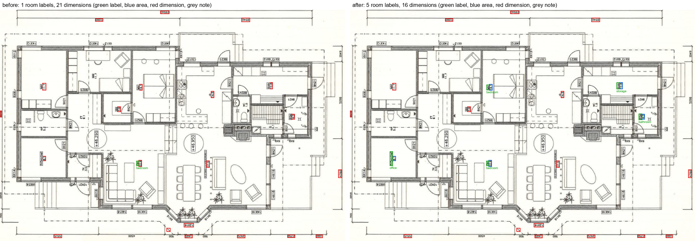
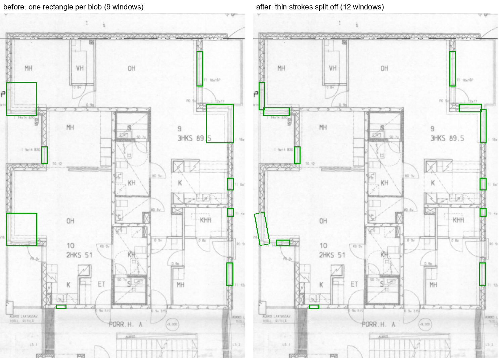
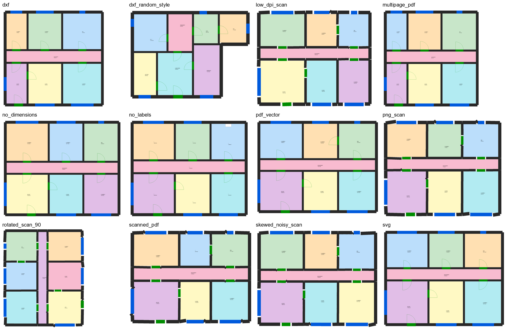

# Milestone 4: real-world robustness

26 October 2026 · follows [Milestone 3](M3_raster_path.md)

## In one paragraph

ReviewPulse now reads room labels in any of ten languages. Every input type passes an end-to-end
acceptance suite: DXF, vector PDF, SVG, multi-page PDF, PNG, scanned PDF, skewed, rotated and
low-dpi scans, a plan without dimensions, and a plan without labels. Scanned pages run in about
40 s each on the GPU, down from 6-15 minutes.

Five defects that real files exposed are fixed:
- Labels outside French and English were not read.
- On scans, the area under a room label was read as a dimension.
- Door and window rectangles grew to swallow nearby stair lines.
- SVG text was all placed at one point.
- A scan could get a confident but wrong scale.

The engine now refuses to FAIL on evidence it cannot be sure of: an absence on OCR-read text, a
room type guessed by the language model, or a drawing that says it is not to scale.

| | before | after |
|---|---|---|
| Room labels → type, CubiCasa5K test (5,011 spaces, clean text) | 6.5% | **99.95%** |
| Room labels → type through OCR (20 test scans, 181 spaces) | 0.6% | **53.0%** |
| Bare numbers read as dimensions (same 20 scans) | 27 | **14** |
| Oversized window / door rectangles (100 test scans) | 42 / 11 | **32 / 8** |
| SVG export of a T1 plan | T3 (texts at one point) | **T1** (8/8 dimensions agree) |
| Acceptance cases passing (12 input types) | – | **12 / 12**, 0 unsafe FAIL |
| OCR time per scan page | 229 s (CPU) | **10 s (GPU)**, CPU fallback |

## 1. Room labels in any language

Room labels come from data, not code. The lexicon has two parts:

- `annotate/lexicon/curated.yaml` lists the 13 room types in French, English, German, Spanish,
  Italian, Dutch, Portuguese, Finnish, Swedish and Arabic, with their common abbreviations. A word
  listed under two types stops loading. That check caught *vestíbulo*, which was listed as both
  corridor and entry.
- `annotate/lexicon/mined_cubicasa.yaml` is generated by `scripts/mine_room_labels.py` from the
  printed labels in CubiCasa5K's ground truth, train and val splits only. A label is kept when it
  appears at least 5 times and at least 80% of uses are one room type: 78 labels, such as MH, KH,
  OH, ET, TK, VH, KHH, PSH and ULKOTILA.

FloorPlanCAD has no text (0 of 50 drawings sampled) and ResPlan has none, so CubiCasa is the only
real label source available.

Accuracy on the 5,011 labelled test spaces, which were never used for mining
(`scripts/eval_room_labels.py`):

| Lexicon | Correct |
|---|---|
| French/English keywords (before) | 6.5% |
| Curated multilingual list | 85.6%* |
| Curated + mined (shipped) | **99.95%** |
| Local LLM alone (qwen2.5:7b) | 59.3%, precision 0.68 |

\* Optimistic: some Finnish curated entries were written after looking at plan 1191, which is in
the test split.

The LLM alone often gets the type wrong. It reads OH as "other", KH as kitchen and PARVEKE
(balcony) as storage. It is therefore only a **fallback** for label-like notes the lexicon does not
know:

- Its output is constrained to a schema, deterministic, and cached on disk.
- Each answer is marked `label_source: llm` with confidence 0.6.
- **No FAIL can rest on a room the LLM typed**: the engine turns it into WARNING "verify room type".

On scans, OCR misreads long words ("OLOHUOME" for OLOHUONE, "keiltio" for keittiö). Those are
matched with edit distance under strict conditions:

- the word has at least 5 letters;
- at most 1 edit, or 2 for words of 9 letters or more;
- only when all the closest entries name the same room type;
- never for vector text.

Two-letter abbreviations are never guessed: UH is not MH.

## 2. Labels and areas on scans

*CubiCasa test plan 1191, OCR texts coloured by how they are read: green label, blue area, red
dimension, grey note. Before: 1 room label and 21 "dimensions". After: 5 labels typed, and the area
lines under them read as stated areas.*

M3 reported vertical labels "duplicated" by OCR. They were in fact two lines of one label: "MH"
above "14.1" (m²). The real defect was that the area line, with its unit lost, was read as a
dimension, and dimensions feed the scale vote.

A bare number stacked against a room label is now taken as that room's stated area:
- it must be on the next line, in the same orientation, within 1.6 text heights;
- outside 1-300 m² (for example "575", a lost decimal point) it is set aside as a note.

Results on 20 OCR'd test scans (`scripts/eval_ocr_labels.py`, cached PaddleOCR words):

| | Labels correct | Stated areas read | Bare numbers as dimensions |
|---|---|---|---|
| Before | 0.6% | 8.8% | 27 |
| Lexicon + stacking | 47.0% | 16.6% | 14 |
| + fuzzy OCR matching | 50.8% | 16.6% | 14 |
| + LLM fallback | **53.0%** | 17.1% | 14 |

The rest is OCR recall:
- 41 of the 181 spaces have no OCR text inside them at all;
- 50 have text misread beyond safe matching.

colorful/10052 reads only 2 words, and that is correct. The plan prints no room labels; its spaces
are colour fills. The only text is the footer "SUUNTAA-ANTAVA, EI MITTAKAAVASSA" ("indicative, not
to scale") and the logo.

That footer led to a new rule, A33. A drawing that declares itself **not to scale** (NTS, "sans
échelle", "nicht maßstäblich", "ei mittakaavassa", and so on in 10 languages) never measures above
T3. DXF model-space units and a user calibration are kept.

## 3. OCR configuration: GPU and CPU

PaddleOCR now runs on the GPU when PaddlePaddle sees one (`ingest/ocr.py: ocr_device()`), and on the
CPU otherwise. The detection model, recognition model and page rotations can be set by environment
variables. Measured on the same 8 CubiCasa test scans:

| Configuration | GPU s/page | CPU s/page | Labels correct | Stated areas |
|---|---|---|---|---|
| **4 rotations, PP-OCRv6 medium (default)** | **10.2** | 229 | **39.8%** (CPU 38.6%) | 7.2% |
| 2 rotations, medium | 6.5 | 95 | 31.3% (CPU 28.9%) | 2.4% |
| 4 rotations, small recognition | 16.4 | 421 | 36.1% (CPU 37.3%) | 6.0% |
| 2 rotations, small recognition | 24.3 | crashed (Paddle CPU segfault) | 30.1% | 1.2% |

The default stays at 4 rotations with the medium models (A34):

- On the GPU it is 22× faster than on the CPU and the most accurate configuration.
- Two rotations lose 8-10 points of labels and most stated areas. Paddle's text-line classifier
  fixes 180° text but not 270° text.
- The small recognition model is slower and less accurate on both devices.

The CPU timings were measured while training jobs shared the machine, so they are upper bounds.

## 4. Door and window rectangles on scans

*CubiCasa test plan 1319, where splitting changes the most. A window blob that ran into balcony or
stair strokes became one large square. Opening it with a disk sized from the blob's own core
thickness splits off the thin strokes, so each part becomes a wall-aligned bar. One tilted
rectangle is still imperfect.*

On 100 test plans (`scripts/eval_opening_rects.py`):
- oversized window rectangles fell from 42 to 32, and doors from 11 to 8;
- rectangle F1 went from 0.791 to 0.806 for windows and from 0.849 to 0.852 for doors;
- mask scores and room F1 (0.873) are unchanged.

## 5. Acceptance: every input type through `rp check`

`python scripts/acceptance.py` (`eval/acceptance.py`, `tests/acceptance/`) builds each input from
the synthetic generators and renders of them, runs the real CLI in a subprocess, and checks:

- the command exits cleanly and writes its reports;
- the tier is one the input can justify;
- walls and rooms were found;
- a T1/T2 sheet measures its rooms **within 10% of the generator's truth**;
- **no unsafe FAIL**: no metric FAIL below T1, no presence FAIL on OCR text, no FAIL on an
  LLM-typed room;
- planted errors are reported: required on vector input, measured on scans.

| Case | Tier | Area / truth | FAIL / WARN | Planted found | s/page (quiet / loaded) |
|---|---|---|---|---|---|
| DXF | T1 | 1.000 | 3 / 0 | 1/1 | 7 / 35 |
| DXF, random style (layers, units, walls, clutter) | T1 | 1.000 | 15 / 3 | – | 7 / 31 |
| Vector PDF | T1 | 1.000 | 2 / 0 | 1/1 | 6 / 21 |
| SVG (PDF exported) | T1 | 1.000 | 1 / 0 | 1/1 | 6 / 20 |
| 2-page PDF | T1 | 1.000 | 4 / 0 | 2/2 | 4 / 8 |
| No dimensions | T3 | 1.000 | 0 / 1 | 1/1 | 6 / 13 |
| No labels (every text removed) | T1 | 0.998 | 20 / 0 | 1/1 | 5 / 19 |
| PNG scan | T3 | 0.604 | 1 / 32 | 1/1 | 38 / 113 |
| Scanned PDF | T3 | 0.973 | 0 / 14 | 0/1 | 44 / 138 |
| Skewed, noisy scan | T3 | 0.972 | 0 / 17 | 1/1 | 48 / 115 |
| Scan rotated 90° | T3 | 0.975 | 0 / 16 | 1/1 | 36 / 111 |
| 100 dpi scan | T3 | 0.971 | 0 / 17 | 1/1 | 35 / 92 |

"Quiet" means the machine was otherwise idle (earlier run). "Loaded" means other streams' training
was sharing the CPU and GPU (final run).

The random-style DXF has no planted errors. Its 15 FAILs are real violations of the example
regulation, because random rooms are not sized to comply.

The scanned PDF found 7 of 7 doors and correct areas. It missed its planted exit error only because
the label of the bedroom concerned was not read, so that room's rule had nothing to apply to.

### What the suite found

1. **SVG text was misplaced (A31).** Exporters put positions on `<tspan>` elements and rotate text
   with matrices. Every label ended up at one point, and the SVG of a T1 PDF fell to T3. Text runs
   are now placed through the transform, with glyph-accurate widths: T1, 8 of 8 dimensions agree.
2. **A wrong scale accepted at full confidence (A35, A36).** On the PNG scan, the end ticks of
   real dimension lines were lost. A wall or door edge 10 mm away, with perpendicular jamb lines,
   passed as a dimension at half length. Three such pairs agreed on 1:186 at confidence 1.0, so
   rooms came out 3.4× too large and doors 1.63 m wide. Two fixes:
   - a dimension text pairs only with the **nearest** parallel line beside it;
   - every scan scale is **checked against the doors**: a median door outside 0.6-1.3 m makes the
     scale an estimate (T3, with a warning), or the title block's scale is used if it fits.

   The PNG is now honestly T3; its area comes from the wall-thickness prior, with the warning.
3. **A crash on non-Latin text.** The low-dpi scan crashed the CLI while printing an OCR'd "口" to
   a cp1252 pipe. Output can no longer crash on encoding.

## 6. Decisions

A25-A36 in [DECISIONS.md](../DECISIONS.md): the label lexicon, fuzzy OCR matching, the LLM fallback
and its guard, label/area stacking, presence rules on OCR text, opening splitting, SVG text runs,
the acceptance suite, not-to-scale notes, the OCR configuration, the door check on scan scales, and
nearest-line dimension pairing.

## 7. Still open

- **OCR recall is the limit on scans.** 23% of labelled spaces have no OCR text inside them.
  Two-letter misreads (UH for MH) are deliberately not guessed.
- **Scan scale without dimensions or title block.** The PNG case falls back to the 0.20 m wall
  prior and measures 0.60 of the true area. It is T3 and flagged, but its measurements are rough.
- **Tick detection on scans.** Thin oblique ticks at 200 dpi are often lost, so dimension
  consensus rarely succeeds on scans. A learned terminator or arrow detector would help.
- **The LLM fallback is weak on abbreviations** (59% alone). It adds 2 points on OCR'd plans and
  never decides a FAIL.
- **CPU-only installs** run OCR at about 4 minutes per page, and the CPU Paddle build segfaulted
  twice under load. A GPU is strongly recommended for scans.
- **Licences.** The mined lexicon comes from CubiCasa5K (CC BY-NC 4.0), as does the scan model:
  both are non-commercial only.
