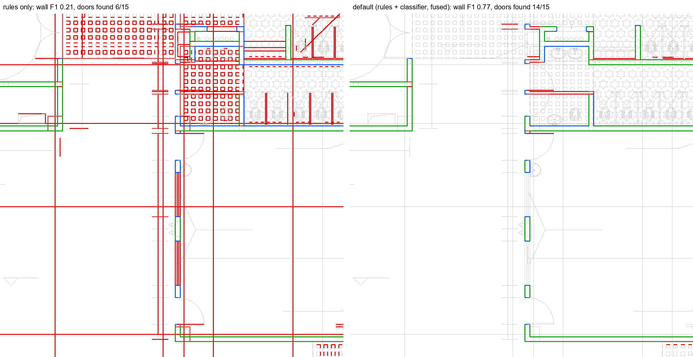
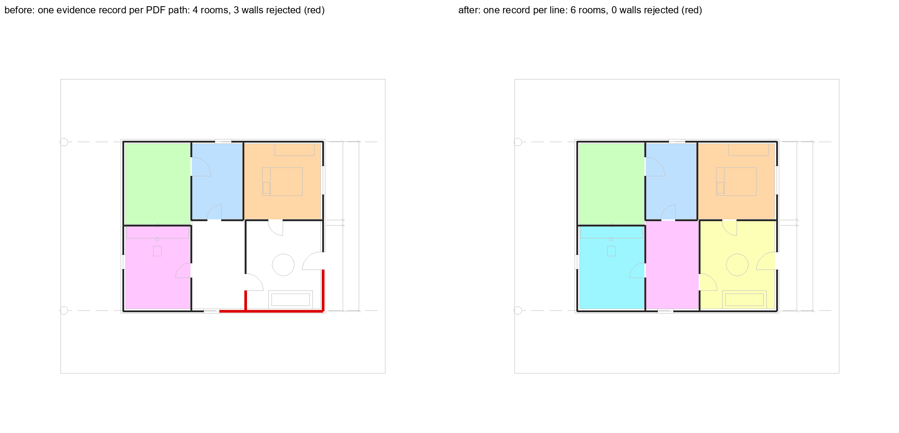

# Milestone 5: a learned pass for real CAD drawings

27 October 2026 · follows [Milestone 4](M4_robustness.md)

## In one paragraph

On real CAD drawings the geometric rules found only a quarter of the walls: furniture, fixtures
and annotation drawn with the same pens pair up like wall faces. A learned classifier now looks at
every line, arc and polygon of a vector drawing and says whether it is a wall, a door, a window or
something else. The rules propose; the classifier disposes. That combination is now the default
for every vector input (DXF, PDF, SVG). On 100 real drawings it nearly doubles wall F1 and lifts
doors from 0.66 to 0.90 and windows from 0.20 to 0.69. On our generated plans it keeps every room
and still finds every planted error. Getting there exposed three defects that would have hit real
customers (one in the PDF reader, one in room outlines, one in training on a laptop that switches
off); all three are fixed and guarded by tests.

| FloorPlanCAD test, 100 real drawings (F1) | rules only | **default now** |
|---|---|---|
| Walls, length-weighted | 0.283 | **0.518** |
| Doors, per instance | 0.657 | **0.901** |
| Windows, per instance | 0.203 | **0.687** |

| Generated plans (60 DXF, 60 PDF, 36 with planted errors) | rules only | **default now** |
|---|---|---|
| Rooms found, DXF / PDF | 474/474 · 474/474 | **474/474 · 474/474** |
| Walls F1, DXF / PDF | 0.999 · 0.999 | 0.996 · 0.995 |
| Doors F1, DXF / PDF | 0.999 · 0.999 | 0.989 · 0.986 |
| Planted errors found | 24/24 | **24/24** |

## 1. Why the rules were not enough on real drawings

The rule pass (Milestones 1 and 2) pairs parallel lines into walls, then finds openings in the
gaps and closes rooms. On our generated plans it is near perfect. FloorPlanCAD (CC BY-NC 4.0)
has 15,000+ real CAD drawings with every primitive labelled, and there the rules reached a wall
F1 of only 0.28. Precision was 0.23: three out of four lines called walls were wardrobes,
counters, stair treads, hatching or text frames. Recall on windows was 0.12, because real windows
are drawn in dozens of ways.

Writing more geometric rules for each of those styles would be special-casing. Instead, the
pipeline learns what a wall line looks like from labelled data.

## 2. The primitive classifier

`perception/learned/` holds a LightGBM model over 43 features per primitive:

- **Shape:** kind, length, orientation, stroke width, fill, dash, arc sweep and radius.
- **Drawing conventions, measured within the sheet:** how common its colour and layer are, so no
  layer names are needed.
- **Neighbourhood:** parallel partners and their distances, end-point connections, crossings,
  density, distance to the sheet border.
- **What the rules concluded:** whether the rules paired it into a wall, with what thickness and
  confidence, and whether they tagged it as hatching, glazing, a dimension or a door leaf.

The last group is what makes it a second pass rather than a replacement: the classifier learns
when to trust the rules.

**Training data.** 6,965 FloorPlanCAD drawings (7.6 M primitives) and 2,000 generated plans, each
as DXF and as PDF (1.3 M primitives). Generated plans are labelled from the generator's truth
geometry (walls, door gaps and swings, window footprints), weighted at 0.3 of the real data.
Validation: 810 real drawings and 300 generated plans never seen in training. The wall threshold
(0.6) is tuned on validation to maximise the mean of the two domains' length-weighted wall F1.

| Validation, length-weighted wall F1 | FloorPlanCAD | generated |
|---|---|---|
| Classifier alone (per primitive) | 0.838 | 0.999 |

## 3. Rules propose, the classifier disposes

The classifier's own calls are good per line (0.75 length F1 on the 100 test drawings), but a
building needs walls with thickness, junctions and closed rooms. Two ways of combining were
compared head to head, as decision D8 requires:

- **Rebuild:** run wall pairing again on only the lines the classifier keeps.
- **Fuse:** keep the rule walls, and change them only where the classifier has evidence. A rule
  wall whose lines the classifier mostly rejects (more than half their length) becomes a
  candidate (`cls: other`, `candidate: true`, kept for review, not deleted). A wall from the
  rebuild that no kept wall already covers is added. Openings are then rebuilt on the fused walls;
  openings the rules had found are re-hosted, and door/window components the classifier finds are
  added on their host wall, marked `needs_confirmation`.

If the classifier rejects every wall the rules found (a drawing style outside its training data),
the rule result is kept and the sheet carries a warning.

| F1 | rules only | fuse | rebuild |
|---|---|---|---|
| FloorPlanCAD walls (length) | 0.283 | 0.518 | **0.569** |
| FloorPlanCAD doors / windows | 0.657 / 0.203 | **0.901 / 0.687** | 0.894 / 0.675 |
| Generated rooms, DXF / PDF | 1.000 / 1.000 | **1.000 / 1.000** | 0.998 / 0.998 |
| Generated doors, DXF / PDF | 0.999 / 0.999 | **0.989 / 0.986** | 0.878 / 0.880 |
| Planted errors found | 24/24 | **24/24** | 24/24 |

One generated DXF plan crashed in the rebuild run on the room-outline defect (section 4); it is
fixed, and the rebuild DXF scores cover the other 59 plans.

Rebuild finds a few more walls on real drawings but loses rooms and a tenth of the doors on
generated plans: when every wall is re-paired, lines the rules had matched correctly can pair
differently. Fuse never makes a plan worse than the rules where the classifier agrees with them,
so **fuse is the default** (decisions D8, A38). `REVIEWPULSE_LEARNED=0` returns to rules only,
and a machine without the model file runs rules only.



*FloorPlanCAD test drawing 0077-0086 (washrooms off a corridor). Green: true wall found. Red: line
called a wall that is not one. Blue: wall missed. Grey: everything else. The rules pair structural
grid lines, floor tiling and the stall partitions into walls (wall F1 0.21, doors 6/15); the default
pass drops them and keeps the walls (wall F1 0.77, doors 14/15). Chosen by `scripts/m5_figures.py`
as the largest gain among the first 12 test drawings with at least 3 doors. Some walls are still
missed (blue): see section 6.*

## 4. Defects found on the way

### Lines of one PDF path shared one evidence record (A37)

The first comparison lost 10 of 474 rooms on generated PDFs, all on plans that draw walls as
polylines. The classifier appeared to give real wall lines a wall probability of 0.0001, while
every similar training example was a wall, and the model itself scored those exact features 1.0.

The cause was in the PDF reader. A PDF path with several segments becomes several primitives, and
they all received the same provenance object. Anything written about one line (a rule tag, the
classifier's call) was written on all of them, and the last write won. The model was right; its
answers were overwritten.

This was not specific to the classifier. Real CAD PDFs draw most of their geometry as
multi-segment paths, so per-line rule tags (hatching, glazing, duplicate counts) were affected on
every real PDF too. Each primitive now gets its own record, and a contract test checks that no two
objects in a model ever share one. The training data for generated PDFs was rebuilt and the model
retrained on it.



*Generated plan 5005 as a PDF, default pass. Left: the defect reproduced; three walls are rejected
(red), the bottom wall no longer closes, and the two rooms behind it are lost (white). Right: the
fixed reader; six rooms, nothing rejected.*

### Room outlines could be stored self-intersecting

Room coordinates are rounded to four decimals when stored. Rounding each vertex on its own could
push two nearly touching edges across each other, giving a self-intersecting outline: areas and
overlaps computed on it are unreliable, and the evaluation crashed on one plan. The whole outline
is now snapped at once with a validity-preserving precision reduction, and a contract test checks
stored outlines.

### Training must survive the laptop switching off

The laptop restarted twice during training. Two fixes:

- Training saves a checkpoint every 100 rounds (about 7 minutes) and continues from it after a
  restart; a checkpoint from other data or parameters is ignored.
- Every checkpoint and cached feature chunk is flushed to disk before it replaces the previous
  one. The first checkpoint after a power cut was a file of zeros: the rename had reached the disk
  before the data.

The evaluation job also skips every step whose report already exists, so a restart costs minutes,
not hours.

## 5. Decisions

- **D8** (rules first, learned models after a head-to-head): head-to-head done; the fused pass is
  the default for vector input.
- **A37** every extracted object owns its provenance.
- **A38** the fusion design and the numbers behind it.

See [DECISIONS.md](../DECISIONS.md).

## 6. Still open

- **Wall recall on real drawings.** The classifier alone reaches 0.81 length recall on walls;
  after pairing into walls it is 0.43. Unpaired wall faces (single-line walls, walls meeting
  furniture) are the next lever.
- **Not every drawing improves.** Of the first 12 test drawings, 10 gain wall F1, one stays at 0
  and one drops from 0.16 to 0 (0011-0041, a sheet with few walls whose lines the classifier
  rejects). The aggregate gain is large, but a reviewer can still meet a drawing where the rules
  alone did better.
- **The model hit its round limit** (4,000 rounds without early stopping), so more rounds may help.
- **Generated doors dropped by 1 point** (0.999 to 0.989): the classifier adds a few door
  components that are not doors. They are marked `needs_confirmation`, so they cannot cause a FAIL
  on their own.
- **Licence.** The model is trained on FloorPlanCAD (CC BY-NC 4.0): non-commercial only until we
  train on data we can use commercially, such as the team's own plans.
- **Real plans.** Every number here is on public or generated data. Plans and a regulation from
  the team remain the most valuable next input.

## Reproduce

```
python scripts/train_primitive_classifier.py --synth 2000 --synth-val 300 --out data/models/primitive_lgbm
rp eval walls --dataset floorplancad --n 100 --method learned --out reports/v4_fuse
rp eval random --n 60 --method learned        # and random_pdf, findings
python scripts/m5_figures.py
```

Reports: `reports/v4_fuse/`, `reports/v4_rebuild/`, `reports/v4_rules/`,
`reports/2026-10-25_walls_floorplancad_rules-oracle-scale.md`.
