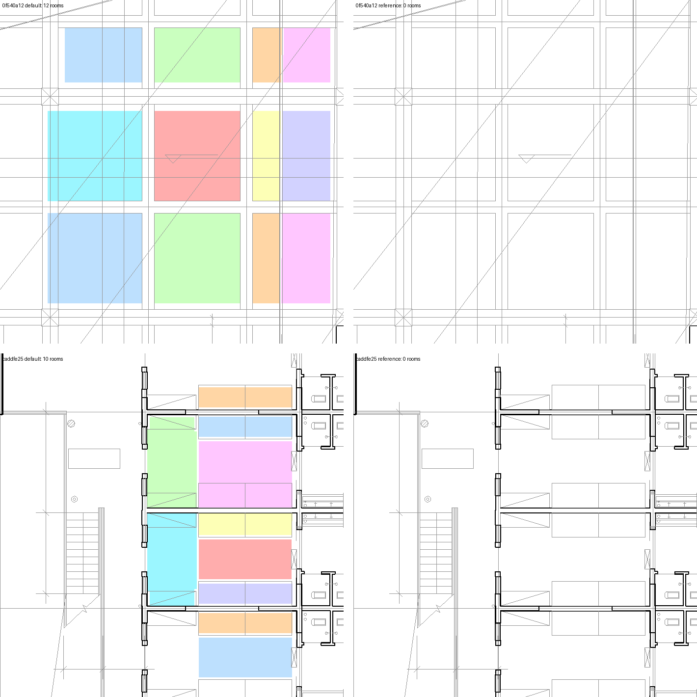
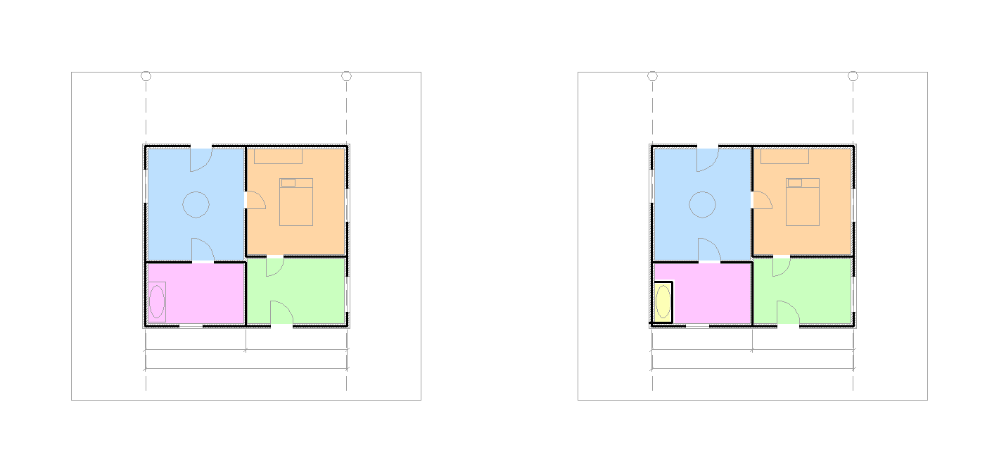
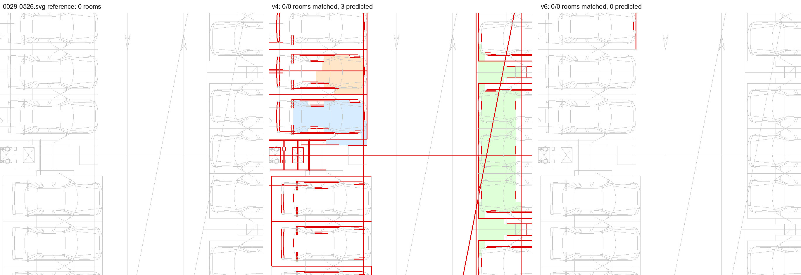
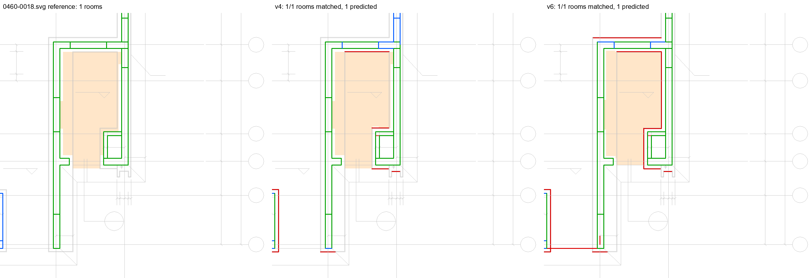
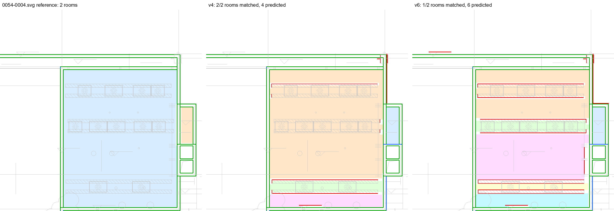
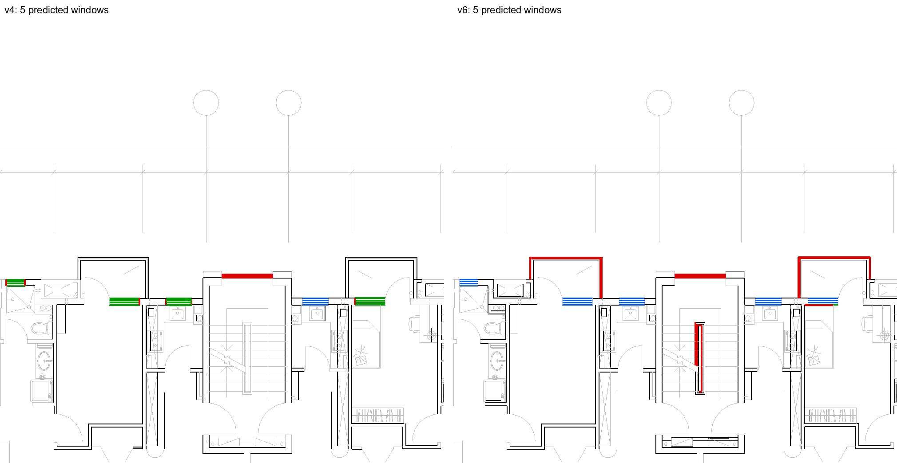
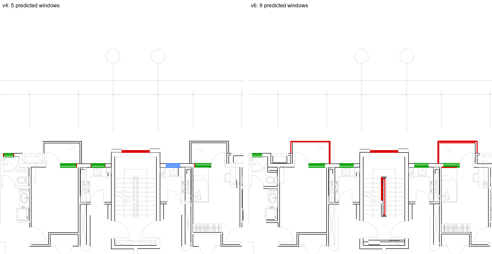

# Milestone 6: checks that matter, a second real domain, and measurements we can trust

28 October 2026 · follows [Milestone 5](M5_vector_learned.md)

## In one paragraph

This milestone did three things. It added checks that reviewers actually make and that a plan
alone cannot answer: walked escape distances, door swing against the escape direction, and the
client's room programme (the brief) read from a spreadsheet or document. It added a second real
CAD dataset, ArchCAD, to train and test on, because one dataset overstated how general the learned
pass was. And it found that several of our own measurements were wrong: an evaluation that wrote
zeros instead of failing, reference rooms that were not rooms, and window counts that split one
window into four. Each of those is fixed and guarded by a test, and the fixes in turn exposed two
real bugs in how rule walls and the classifier are combined, a third that made rooms too small,
and a fourth that lost windows. All are fixed, and the default model is now trained on both real
datasets. Planted errors on generated plans are still found 24 out of 24 throughout.

| 100 real drawings per dataset (F1 unless noted) | before | **now** |
|---|---|---|
| ArchCAD rooms | 0.37 | **0.68** |
| ArchCAD rooms with area within 5% | 47% | **54%** |
| ArchCAD walls / doors / windows | 0.40 / 0.83 / 0.48 | **0.52 / 0.91 / 0.69** |
| FloorPlanCAD rooms | 0.747 | 0.742 |
| FloorPlanCAD rooms with area within 5% | 45% | **59%** |
| FloorPlanCAD walls / doors / windows | 0.544 / 0.90 / 0.69 | 0.530 / 0.90 / **0.81** |
| Generated plans: rooms (DXF, PDF) | 1.000, 1.000 | 1.000, 1.000 |
| Planted errors found | 24/24 | 24/24 |

"Before" is the default this milestone started from; "now" is the new code with the new model.
Two numbers went down slightly (FloorPlanCAD walls by 1.4 points, FloorPlanCAD rooms by about one
room in 66). We adopted the change anyway because the gains are large and are in what reviewers
check: room areas, rooms and windows (decision A51).

## 1. Checks reviewers make

The full list of what a reviewer checks, and which of it we cover, is in
[check_inventory.md](../check_inventory.md). This milestone added:

- **Escape distance, walked (C-T5, A40).** The distance is measured along a path that stays
  inside rooms and passes through doors, from the farthest point of each room, not from its
  centre. An independent grid search agrees within 0.6 m on every room of a test plan. Measuring
  properly showed that our own generator drew "clean" flats that broke the example 15 m limit in
  40 out of 40 seeds; the generator was fixed, not the check.
- **Door swing against the escape direction (C-T6).** Shipped as a draft template: no document
  we have states it yet, so it cannot become an approved rule on its own.
- **The brief (K-P1, A41).** `rp check plan.pdf --brief brief.xlsx` reads the client's room
  programme (CSV, XLSX, DOCX, PDF or Markdown, French or English headers) and checks room counts
  per type and room areas. A missing room is not reported as a FAIL while some rooms have no
  readable label: the missing one may simply be unlabelled.
- **Drafting rules from real regulations (A42).** On 171 sentences of real building regulations
  (CODE-ACCORD, England and Finland), the local model reads the number correctly 78 times out of
  105. The dangerous case is a draft with the comparison the wrong way round and no warning: 13
  of 171. Wording flags that do not depend on the model (ranges, "may", clauses with both a
  minimum and a maximum) bring that to 11, and to 1 among clauses a drawing can check.

## 2. A second real domain: ArchCAD

ArchCAD (CC BY-NC 4.0) has 41,097 slices of real architectural and structural CAD, every line
labelled. It has no text, no layers and one colour, so only geometry separates a wall from
anything else (A44).



*Two ArchCAD test slices where the model trained only on FloorPlanCAD built rooms (left) where
the labels have none (right): a structural beam grid (top) and parking bays (bottom).*

Adding ArchCAD to training (model v5) raised rooms on ArchCAD from 0.37 to 0.59 F1, but it also
taught the model that some closed outlines are walls. On one generated plan it called a bathtub
outline a wall and cut a 1 m2 false room out of the bathroom. The fix is a general rule (A39): a
small closed outline wider than any wall (measured by the largest circle that fits inside it) is
an object, and its lines never become walls.



*Generated plan 5033 as PDF with model v5. Left: after the object rule, four rooms, bathroom
10.1 m2. Right: before it, the bathtub outline (yellow) became a room.*

Model v6 adds text-context features: how far each line is from the nearest dimension, tag, room
label or note. On top of v5 it gained about one point of wall F1 and three points of room F1 on
ArchCAD, and nothing on FloorPlanCAD.

## 3. Measurements that were wrong

Every number in a progress report is only as good as the evaluation behind it. Looking drawing by
drawing at where v6 lost against v4 turned up four faults in our own measurements.

| Fault | Effect | Fix |
|---|---|---|
| Training stopped on Windows (a stale feature file was still open when it was replaced); the evaluation then ran without a model and wrote zeros | A report of zeros, and synthetic steps that would have scored rules alone under the name "learned" | Close the file; an evaluation that cannot run what it names stops; a run where every drawing crashed is not a result (A45) |
| The learned pass falls back to the rule walls when the classifier rejects them all, and that fallback also fired on the true labels | Where the labels mark no walls (a car park), reference "rooms" were bay lines and car outlines: 15 of 81 FloorPlanCAD reference rooms | The fallback guards against the classifier only (A46) |
| ArchCAD windows were grouped by touching lines; a window symbol is 2 to 4 parallel panes that do not touch | 376 "true windows" on the test slices were 111; one predicted window was credited with four | Panes side by side are one window; windows in a row stay apart (A44) |



*FloorPlanCAD 0029-0526, a car park. The labels mark no walls. Left: the old reference, which fell
back to rule walls and found 3 "rooms". Middle: v4 matched them by making the same mistake. Right:
v6 found no walls and no rooms, which is correct. Red: called a wall, not one in the labels.*

## 4. Two bugs in combining rules and the classifier

With the measurements fixed, the remaining v6 losses on FloorPlanCAD rooms came from two real
bugs, both general:

- **A tie at one half (A47).** A rule wall was kept when the classifier called at least half its
  length a wall. A pair of equal lines with one called a wall and one not ties at exactly one
  half and was kept. Free-standing hatched strips in a hall (equipment rows) were kept this way
  and cut the hall into 8 rooms. The decision now uses the classifier's probabilities, weighted by
  length, against the model's tuned threshold.
- **An assumed thickness treated as a drawn one (A48).** A line the classifier calls a wall but
  that has no partner line becomes a wall with an assumed thickness. The step that removes
  objects drawn against walls (two bodies side by side, too thick together) treated that assumed
  thickness as real, and dropped true walls. On drawing 0460-0018 this lost 23 true wall lines
  and a room. Assumed thicknesses no longer take part, and where two drawn bodies do clash, the
  one the classifier believes is kept.



*FloorPlanCAD 0460-0018. Green: true wall found. Red: called a wall, not one. Blue: wall missed.
After the fixes both models close the room and its area is within 5% of the reference.*



*FloorPlanCAD 0054-0004. Hatched equipment strips inside a hall are still called walls by both
models (red) and split the hall. The probability fix removed two of them; the classifier is
genuinely unsure about the rest.*

## 5. Rooms too small, and windows lost

Two more problems showed up once the measurements were right.

- **Rooms came out too small.** Under half of the matched rooms had their area within 5% of the
  reference, and they were nearly always too small. Splitting the difference showed a thin band
  missing along walls. Those walls paired a true wall face with a line inside the room: a lift
  car inside its shaft, a fixture, a finish line. The wall body then reached into the room. The
  classifier already knew better: rebuilt from only the lines it believes, the wall sits in the
  right place. Such a wall is now replaced by the rebuilt one (A49).
- **Windows were lost.** The classifier gave the glass lines of a window a probability of 0.99,
  and yet no window came out. A window is drawn as 2 to 4 parallel panes that do not touch; the
  step that groups window lines joined only touching lines, so each pane stood alone and a single
  line was dropped. Panes side by side now form one window (A50), with the same test the
  dataset truth uses.





*ArchCAD slice 1a30af18, previous model (left of each image) and new model (right). Blue: true
window not found. Green: window found. Red: called a window, not one. Before the fix (top) the new
model found 1 of the 5 windows: the panes of the other four stood alone and were dropped. After it
(bottom) the new model finds all 5. The red balcony outlines and stair handrail are still called
windows (section 8).*

## 6. Tried and not adopted

- **A vision-language model as a second reader for scanned labels (A43).** On 20 scans, labels
  read correctly stayed at 50.8%. Of 120 words it re-read, 81 answers were inventions; on a blank
  crop it answered "10'x20' Living Room". It stays off by default, behind an agreement gate.

## 7. Decisions

A39 to A51 in [DECISIONS.md](../DECISIONS.md): object outlines, walked escape distances, the
brief, drafting flags, the vision second reader, ArchCAD, evaluation guards, true labels never
second-guessed, fusion by probability, assumed thicknesses out of the glued-body test, walls
rebuilt from believed lines, window panes, and the new default model with the adoption rule.

## 8. Still open

- **Room areas.** 59% and 54% of matched rooms within 5% is much better, but area rules need
  more. Of what is still wrong, part is whole pieces of rooms cut off or added, not just bands.
- **Free-standing strips.** Long hatched equipment strips in a hall are still called walls when
  the classifier is unsure about them (0054-0004).
- **False windows** on balcony outlines and stair handrails (ArchCAD 1a30af18, red above).
- **FloorPlanCAD walls** dipped slightly with the new model (0.544 to 0.530).
- **Real projects.** Every number here is on public or generated data. Plans with their
  reviewers' comments, and the regulation that applies, remain the most valuable next input.

## Reproduce

The result files behind every number above are in `reports/m6_final/` (what each folder holds is
in its README).

```
python scripts/train_primitive_classifier.py --synth 2000 --synth-val 300 --archcad 6000 --archcad-val 600 --out data/models/primitive_lgbm_v6
rp eval walls --dataset archcad --n 100 --method learned         # and --dataset floorplancad
rp eval random --n 60 --method learned                           # and random_pdf, findings --n 36
python scripts/eval_rooms_real_cad.py --dataset archcad --n 300  # and --dataset floorplancad --n 40
python scripts/eval_drafting_code_accord.py
python scripts/eval_ocr_labels.py --n 20 --vlm
```
