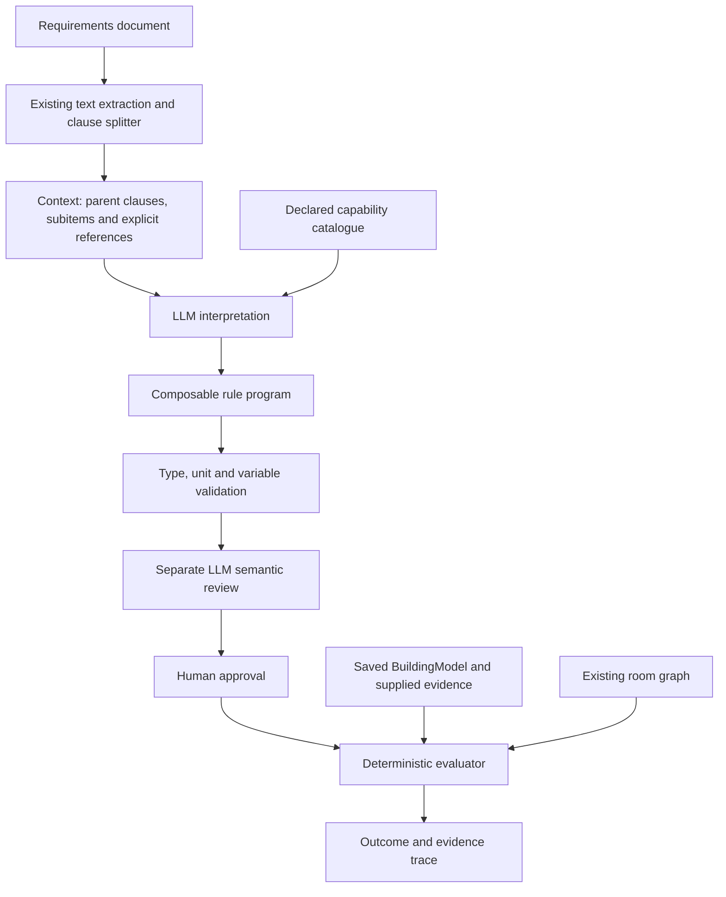

# Review-Pulse rule interpreter: team handoff

Branch: `rule-interpreter`. Prepared 4 November 2026.

## What we implemented

The new interpreter converts a requirement and its available source context into a composable
rule program. It validates the program, obtains a separate semantic review, records explicit
human approval, and evaluates the accepted interpretation against building facts. Missing or
unverified evidence remains visible instead of becoming an assumed false value.

This is an opt-in workflow alongside the existing simple-rule system. It is available through
`rp interpret` and `/api/interpreter` endpoints. It is not yet integrated into the existing Rules
tab, project draft persistence, or annotated PDF/HTML findings.

## Architecture



Two LLM roles are used: interpretation and semantic criticism. They can use the same configured
model with different prompts, or different models. Separate roles do not guarantee independent
errors. Model review is an aid to human review, not a proof of source fidelity.

The floor-plan extraction pipeline is not replaced. The interpreter consumes its saved building
representation and reuses the existing room-graph builder. No comparison of a regulation graph
with a building graph is required: a rule program is executed against building facts.

## Technologies

| Technology | Actual role |
|---|---|
| Python | Context assembly, validation, approval, evaluation and integration |
| Pydantic v2 | Closed expression schema, typed inputs, program and review records |
| Ollama and Qwen2.5:7B | Default existing model client for interpretation and review |
| Existing optional Claude client | Alternative hosted backend |
| NetworkX | Qualifying-route search using the existing room graph |
| Existing BuildingModel | Room geometry, labels, measurements, openings and provenance |
| Typer | `rp interpret` command group |
| FastAPI | Stateless interpreter endpoints in the existing application |
| Pytest and Ruff | Automated behavior/integration tests, lint and formatting |

No training, fine-tuning, unrestricted generated Python, Z3 solver or multi-agent orchestration
framework is part of this implementation.

## Processing stages

### 1. Assemble traceable context

The existing document readers split documents into clauses with character offsets. The new context
assembler follows parent/subitem relationships, explicitly linked clauses and numbered references.
It detects cycles and uses a bounded context budget. Missing, ambiguous or truncated dependencies
are retained as unresolved issues. Additional definition/reference links can be supplied explicitly.

It does not yet automatically reconstruct all PDF headings, tables, footnotes or external standards.

### 2. Declare what evidence is available

An input file declares fact names, types, units and descriptions. Individual facts include their
value, source, trusted flag and conflict flag. Collections identify members and separately state
whether membership is trusted and whether the inventory is complete.

The building adapter exports existing room types, room areas, minimum room widths and opening
widths. Additional project or schedule facts must be declared and supplied explicitly. The LLM
cannot invent a new physical measurement implementation by naming it.

### 3. Interpret the complete requirement

The LLM produces a draft program with applicability, exemption and requirement expressions,
exact source quotes and unresolved issues. Source quotes are checked against original offsets.
The model cannot approve itself or erase missing context dependencies.

Applicability determines whether a requirement governs a case. Exemption removes the obligation
under a stated condition. Alternative ways to satisfy an obligation belong inside the requirement
expression. A permission must not be turned into a requirement to exercise that permission.

### 4. Validate and review

Static validation rejects unsupported operations, extra fields, unbound or shadowed variables,
invalid expression types and incompatible units. A separate semantic-review prompt examines the
source and program for omitted conditions, lost exceptions, wrong comparisons and scope errors.

The review fingerprint covers the interpretation, source context and declared capability semantics.
Changing those invalidates the review. The approval operation requires a named reviewer and
rejects unresolved dependencies, review issues, limitations or a stale review.

### 5. Evaluate and explain

The evaluator runs the accepted program without another LLM call. It returns a structured tree of
consulted evidence, intermediate values and missing information. Runtime work is bounded.

| Outcome | Meaning |
|---|---|
| `SATISFIED` | Available trusted evidence establishes the requirement |
| `VIOLATED` | Available trusted evidence establishes a violation |
| `NOT_APPLICABLE` | The applicability condition is false |
| `EXEMPT` | The exemption condition is established |
| `UNRESOLVED` | Meaning, applicability or decisive evidence remains uncertain |

Previewing a draft is explicit and labelled. These richer outcomes are kept separate from the
legacy four-verdict finding format until the interface/report migration is implemented.

## What makes a rule compositional

The expression language supports nested AND/OR/NOT, comparisons, unit-aware arithmetic, finite
universal/existential quantification, filtered collections, counts, sums, minimums, maximums and
qualifying-route existence.

That permits a requirement to combine several operations instead of selecting only one complete
predefined checker. For example:

- Require all conditions of an inner-room arrangement, including one of several warning alternatives.
- Sum available capacity after excluding a largest contribution, then compare against occupancy.
- Apply an exception only when a ratio and several other conditions all qualify.
- Find one route whose room restrictions and opening-width restrictions hold together.

The route implementation searches a known graph and a possible graph. It does not separately find
a route, a compliant door and a compliant corridor and assume they form one valid route.

## Treatment of incomplete information

Unknown, untrusted and conflicting facts remain unknown. A true alternative can establish
satisfaction despite an unknown sibling; an uncertain exemption can prevent a definite violation.

Inventory completeness is important: a known qualifying member can establish existence, but an
incomplete inventory cannot establish that no qualifying member exists. Universal satisfaction
and aggregates need the corresponding completeness/evidence guarantees. Entirely empty universal
scopes are conservatively unresolved.

Deterministic execution means repeatable decisions from the same accepted program and inputs.
It does not establish that the source interpretation or extracted building representation is correct.

## Repository and code map

The active application now lives at the repository root. `src/reviewpulse` is its Python package;
the earlier DeepFloorPlan prototype is preserved in `legacy/deepfloorplan`.

| Module under `src/reviewpulse/interpreter/` | Responsibility |
|---|---|
| `schema.py` | Programs, expressions, source spans and input contracts |
| `context.py` | Source context and dependency assembly |
| `draft.py` | Source-grounded interpretation through the existing LLM client |
| `validate.py` | Static type, unit and variable checks |
| `review.py` | Semantic criticism, fingerprints and shared approval policy |
| `runtime.py` | Partial evaluation, graph search and evidence traces |
| `building.py` | Adapter for the existing building model and graph |
| `examples.py` | Three offline illustrative compound examples |
| `cli.py` | Command-line workflow |
| `api.py` | HTTP workflow using the same core operations |

## How a teammate can run it

Run these commands from the repository root after the normal project setup:

```powershell
rp interpret demo runs/interpreter-demo
rp interpret check runs/interpreter-demo/exit_capacity/program.json runs/interpreter-demo/exit_capacity/inputs.json runs/interpreter-demo/result.json --preview
```

The demo writes source context, a draft program, input facts and four expected scenarios for each
of three examples. These are illustrative subsets, not full legal encodings.

For an actual document:

```powershell
rp interpret context requirements.md "Art. 9" context.json
rp interpret inputs runs/plan/building_0.json inputs.json
rp interpret draft context.json inputs.json draft.json
rp interpret check draft.json inputs.json preview.json --preview --building runs/plan/building_0.json
rp interpret review draft.json context.json inputs.json review.json
rp interpret approve draft.json context.json inputs.json review.json approved.json "Reviewer name"
rp interpret check approved.json inputs.json result.json --building runs/plan/building_0.json
```

Adjust the target clause id to the actual document. Configure a running model for draft/review.
Inspect the rule and independently specified scenarios before approval. The application also
exposes the workflow under `/api/interpreter`; request schemas appear in `/docs` when it runs.

## Validation and remaining work

After the repository reorganization, the full fast-test run passed 320 cases, skipped four and
excluded 36 slow cases. Two additional cases initially could not run because the isolated test
environment lacked the already-declared Word/Excel dependencies. With those installed, the entire
eight-case programme-document module passed on rerun. This gives passing observed results for all
322 unique executed cases; the full suite was not repeated after installing those dependencies.
The three demonstrations matched all 12 expected outcomes. Root imports, baseline paths,
setup-script syntax, lint and whitespace checks also passed. Automated model calls use offline stubs.
The root-layout `rp doctor` self-check passed as well: installation checks, generated DXF/PDF
pipelines and the web-app upload/check flow all succeeded, finding all three planted errors in
each exercised flow. Docker configuration paths were checked; a Docker image was not built.

The local drafting model was unavailable, so real-model extraction accuracy has not been measured.
Passing software tests is not a claim of reliable general interpretation of unseen regulations.

Next work is full-source expert-reviewed evaluation, stronger document/table context extraction,
structure-aware example retrieval, bounded interpretation repair, distinguishing-case generation,
and integration into project persistence, the review UI and finding exports. General normative
priority resolution, temporal obligations and multi-floor building assembly are not implemented.

For detailed expression and evidence semantics, see [the technical guide](regulation_interpreter.md).
