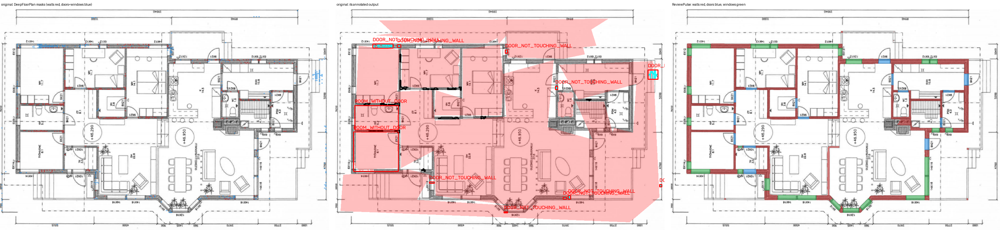
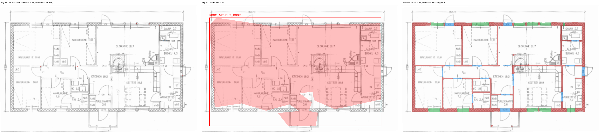
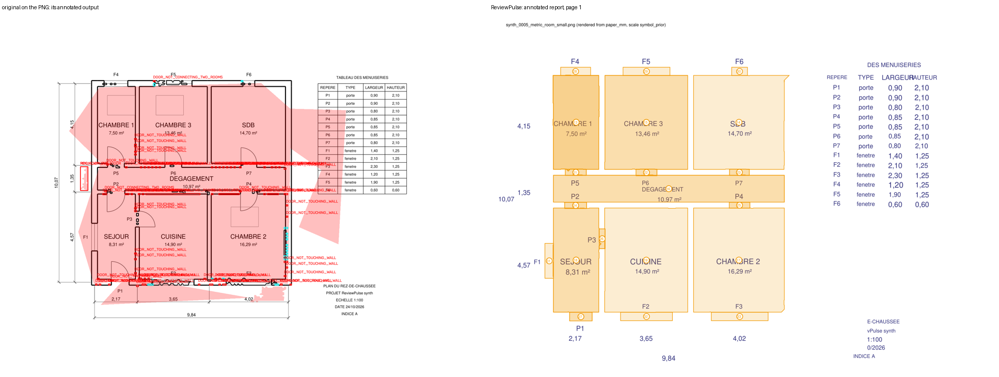
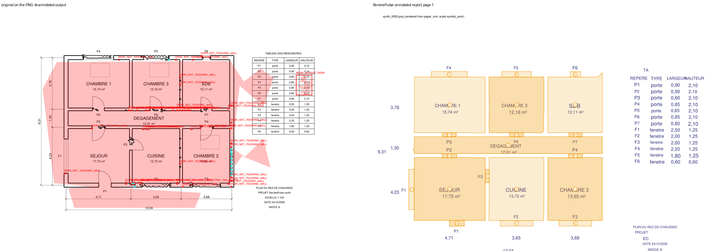

# Baseline 0: the original pipeline, measured (task A1)

26 October 2026 · original code: repo root (`main.py`, `model/`, `preprocessing/`, `detection/`,
`geometry/`, `rules/`, `visualization/`, `utils/`), commit `9b9a639`, run unmodified.

## In one paragraph

The original pipeline runs. With the public DeepFloorPlan weights it finished all 60 inputs
without a crash: 30 CubiCasa5K scans, plus 15 synthetic plans each as PNG and as PDF. What it
produces is not usable for checking a plan against requirements:

- **Walls:** its masks are reasonable (F1 0.68 within 3 px, on the same 30 plans and pixels).
- **Doors and windows:** close to zero (instance F1 0.01 and 0.02), because one fragmented
  "opening" mask is used for both.
- **Rooms:** 1 in 4 matched (F1 0.26).
- **Planted errors:** on synthetic plans it found none of 20 on the right room. It reported
  66-74 violations on every *clean* plan, 80-82% of them "door not touching wall".

ReviewPulse on the same inputs:

- **CubiCasa5K:** walls 0.95, doors 0.84, windows 0.81, rooms 0.91.
- **Synthetic plans:** it found 19 of 20 planted errors, with no FAIL on any clean plan.

It's also 7-90x faster per plan, but the hardware differs (see section 2). The one thing the
original does better than a ReviewPulse component is wall precision: 0.85 against 0.53 for
ReviewPulse's *rule* baseline on scans. ReviewPulse's default scan path, its trained model,
reaches 0.92.

## 1. What the original pipeline is

`python main.py <plan.png|jpg|pdf>` runs a DeepFloorPlan network and four checks on its output.

| Step | Module | What it does |
|---|---|---|
| Load | `preprocessing/input_loader.py` | Reads an image with OpenCV. For a PDF, only the **first page** is rasterised at 300 dpi through pdf2image, which needs Poppler. |
| Model | `model/deepfloorplan_inference.py` | Resizes the page to **512 × 512** and runs the SavedModel in `store/model`. The model is **loaded again on every run**. Masks are resized back to the page size and cut at 0.35. |
| Classes | same | The TF2 export has a room-type head with 9 classes and a boundary head with 3 (background, wall, opening). Rooms are "any room class". The larger boundary class becomes wall and the other one door. **Windows are a copy of the door mask** (`infer_windows_from_openings = True`), so doors and windows are never told apart. |
| Clean-up | `detection/mask_postprocess.py` | Walls get a 3 × 3 closing. Rooms get a 3 × 3 opening, then the dilated wall band is subtracted so neighbouring rooms stay separate. Door and window geometry comes from the raw masks (`use_raw_openings_for_geometry`). |
| Geometry | `detection/contour_extraction.py`, `geometry/polygon_builder.py` | Contours become Shapely polygons, with minimum areas in px² (rooms 900, doors and windows 25, walls 40). |
| Graph | `geometry/spatial_graph.py` | Room–door adjacency, using buffers in pixels (10–18 px, with an adaptive term). |
| Checks | `rules/compliance_rules.py` | `MIN_ROOM_AREA` (room area < **2 500 px²**), `DOOR_NOT_TOUCHING_WALL` (6 px tolerance), `ROOM_WITHOUT_DOOR`, `DOOR_NOT_CONNECTING_TWO_ROOMS` (one-sided doors allowed on the building outline). |
| Outputs | `rules/violation_report.py`, `visualization/overlay_renderer.py` | `outputs/report.json` (rooms, doors and windows as **bounding box + area in px²**, plus violations), an annotated PNG, per-class masks, and the room graph as JSON and PNG. |

Behavioural limits that follow from the code itself, independent of how well the network does:

- **No scale, no units.** Every length and area is in pixels of the input image. The same room
  passes or fails the 2 500 px² rule depending on the dpi it was scanned at. At 200 dpi and 1:100,
  2 500 px² is about 0.4 m², so the rule essentially never fires on a real room.
- **No text.** No OCR, no room labels, no dimensions, no tags or schedules. A check can't know what
  kind of room it is looking at, so it can't apply a rule written for bedrooms.
- **No requirements document.** The four checks and their pixel thresholds are fixed in code
  (`utils/config.py`). Nothing reads a regulation, and there's no per-project rule set.
- **No vector input.** DXF, DWG and SVG aren't read. A vector PDF is rasterised first, so its exact
  geometry and text are thrown away.
- **No uncertainty.** Every violation is reported the same way. There's no confidence, no tier and
  no "verify" state, and nothing links a violation back to the drawing elements that decided it.
- **One page.** Multi-page PDFs are silently cut to page 1.

## 2. How it was run (reproducible)

- **Code**: the original files, unmodified.
  [`scripts/baseline_run.py`](../scripts/baseline_run.py) imports `main` and calls `main.main()`
  with `sys.argv` set exactly as the command line would. To score the geometry with the same metrics
  as ReviewPulse, it wraps three functions `main.py` imports
  (`_prepare_masks_for_contour_extraction`, `build_geometries`, `check_compliance`). Each wrapper
  calls the original and keeps a copy of what it returns. Behaviour is unchanged.
- **Environment**: its own venv, `reviewpulse/.baseline_venv` (Python 3.11, root
  `requirements.txt`, TensorFlow 2.21 CPU, OpenCV, scikit-image, Shapely, pdf2image with Poppler
  24.08).
- **Weights**: the team-drive `store/` folder the README asks for isn't available. The public
  TF2DeepFloorplan SavedModel (VGG16 backbone, trained on R3D, GPL-3.0) was used instead: source and
  sha256 are in [data/LICENSES.md](../data/LICENSES.md). The harness runs from a work directory
  that holds it as `store/model`, which is the path `utils/config.py` expects. Any number below is a
  measurement of *this code with these public weights*. The team's own weights, if they differ,
  would need a rerun of the same script.
- **Inputs**:
  - **30 CubiCasa5K test plans**, taken from the 100 that ReviewPulse's raster evaluation uses,
    as the same renders (`data/processed/cubicasa_seg/test`, longest side 1024 px), so both
    pipelines see identical pixels. The 30 are evenly spread over the 100 and chosen
    deterministically (plan `i × 100 // 30` for i = 0…29). The list is in
    `runs/baseline/inputs_cubicasa.txt`; the full 100 are in `inputs_cubicasa_100.txt`.
    - *Why 30, not 100:* the original takes 6–7 minutes per plan while the laptop's CPU is shared
      with a training job. The model is reloaded on every call, and TensorFlow runs on CPU only.
      At that rate 100 plans would take over 12 hours.
    - *Comparable:* ReviewPulse is scored again on exactly the same 30 plans
      (`baseline_score.py rp-cubicasa`, through `eval/raster_eval.run(names=...)`) rather than
      quoting its 100-plan numbers. Both columns of the head-to-head therefore cover the same
      plans.
  - 15 synthetic plans from `reviewpulse.synth.make_plan`, each as PNG (200 dpi) and as vector
    PDF: 5 clean, 5 with a planted undersized room, 5 with a planted room that has no door. Those
    are the two planted errors the original's four checks can express.
- **Scoring**: [`scripts/baseline_score.py`](../scripts/baseline_score.py) runs in the ReviewPulse
  venv and calls the scoring functions of `eval/raster_eval.py` unchanged:
  - walls: pixel F1 within 3 px, and IoU;
  - doors and windows: connected-component instances at IoU 0.5 and 0.3, Hungarian matching;
  - rooms: polygons at IoU 0.5 against the CubiCasa room polygons, with open-plan neighbours
    merged.

  On the synthetic plans, a planted error counts as found only when a violation of the matching
  type names the room that contains the planted room's centre.
- **Runtime**: wall-clock time per call on the team laptop (Windows 11, 20 logical cores, RTX A1000
  laptop GPU). Other jobs (a 10-worker training run) were sharing the CPU during the runs, so read
  every number as an upper bound. The two pipelines are timed on different hardware paths, and the
  timing comparison carries that caveat:
  - **Original**: TensorFlow 2.21 runs on the **CPU**, because TensorFlow has no native GPU support
    on Windows since 2.11. The SavedModel is reloaded on every call, as its code does. The one-off
    TensorFlow import is reported separately.
  - **ReviewPulse**: the segmentation model (PyTorch, CUDA) and PaddleOCR (paddlepaddle-gpu) both
    run on the **GPU**. OCR on GPU took 39 s per page against 339 s on the CPU, measured on the same
    CubiCasa scan. OCR is the slowest step of a scanned page.

## 3. Results

### 3.1 Did it run?

| Input set | Inputs | Exit 0 | Crashes | Median s / input (original) | Median s / input (ReviewPulse) |
|---|---|---|---|---|---|
| CubiCasa5K test renders | 30 | 30 | 0 | 147 | - (scored through the eval harness, not timed per plan) |
| Synthetic plans, PNG 200 dpi | 15 | 15 | 0 | 367 | 49 (`rp check`, GPU OCR) |
| Synthetic plans, vector PDF | 15 | 15 | 0 | 326 | 3.6 (`rp check`, vector path) |

- **TensorFlow import:** 80 s once per process, on top of the per-input times. Running
  `python main.py` once per plan, as its README shows, pays it on every call.
- **Model reload:** the SavedModel is reloaded inside every call.
- **Timing caveat:** the original runs on CPU and ReviewPulse on GPU, and other jobs were sharing
  the CPU (section 2), so read the speed ratio as indicative only. On a single synthetic plan, the
  original's own time rose from 99 s to 413 s depending on what else was running.

### 3.2 Perception on 100 CubiCasa5K test plans (same pixels, same scoring)

The same 30 plans and the same pixels, scored by `eval/raster_eval.py` for both pipelines
(`reports/baseline/cubicasa.json`, `reports/baseline/rp-cubicasa.json`). F1 is shown with
precision / recall.

| | Walls F1 (3 px) | Walls IoU | Doors F1 (IoU 0.5) | Windows F1 (IoU 0.5) | Rooms F1 (IoU 0.5) |
|---|---|---|---|---|---|
| **Original** (DeepFloorPlan, public weights) | 0.68 (P 0.85 / R 0.57) | 0.38 | 0.007 | 0.019 | 0.26 |
| ReviewPulse rule baseline (no learning) | 0.67 (P 0.53 / R 0.92) | 0.39 | 0 | 0 | 0.32 |
| **ReviewPulse model**, same render | **0.95** (P 0.92 / R 0.98) | **0.79** | **0.83** | **0.77** | 0.86 |
| **ReviewPulse model, full-resolution scan** (the `rp check` path) | **0.95** | **0.79** | **0.84** | **0.81** | **0.91** |
| *Room detector given the true walls and openings (upper bound)* | | | | | *0.98* |

- **Doors and windows:** even at the lenient IoU 0.3 the original reaches only door 0.02 and window
  0.03. Its export has a single "opening" class, and its window mask is a copy of the door mask.
  - Measured on its pixels, that opening mask falls 44% on true windows, 21% on true walls and 14%
    on true doors.
  - It splits into 2,511 fragments against 342 true doors, so almost no fragment overlaps an
    opening well enough to match.
  - It isn't a swap of the wall and opening classes: scoring walls + openings as walls gives the
    same wall F1 (0.68).
- **Rooms:** its room mask is "any room class". In several plans it covers the whole page
  including outside the building (figure 1, middle), which is why rooms that do exist fail the
  IoU match.
- **Training data:** the public weights were trained on R3D, not CubiCasa5K, so part of the gap is
  a change of dataset. The team-drive weights the README refers to may have been trained
  differently; the same script would measure them (section 5).

### 3.3 Planted errors on synthetic plans

15 synthetic plans with exact truth, each as a 200 dpi PNG and as a vector PDF. The original's
four checks can express two of ReviewPulse's planted errors: an undersized room (`MIN_ROOM_AREA`,
ReviewPulse C-D3) and a room without a door (`ROOM_WITHOUT_DOOR`, ReviewPulse P-6). Only those two
are planted, so the comparison is on the original's own ground.

| | Planted errors found on the right room | Violations on 5 clean plans | Of which FAIL |
|---|---|---|---|
| **Original**, PNG | **0 / 10** (in 9 / 10 plans the violation type appears, but on other rooms) | **330** (66 per plan) | n/a, no verdict levels |
| **Original**, PDF (rasterised at 300 dpi) | **0 / 10** (10 / 10 elsewhere) | **369** (74 per plan) | n/a |
| ReviewPulse, PNG (scan path, T3) | 9 / 10 | 124 WARNING "verify" (25 per plan) | **0** |
| ReviewPulse, vector PDF (T1/T2) | **10 / 10** | **0** | **0** |

- **Original on clean plans:**
  - `DOOR_NOT_TOUCHING_WALL`: 270 of the 330 violations on PNG, and 297 of 369 on PDF. These are
    door fragments a few pixels off a wall fragment (figure 3).
  - `MIN_ROOM_AREA`: 8-9 per format, all on room-mask slivers. Its 2 500 px2 threshold is about
    0.4 m2 at 200 dpi, so a real undersized bedroom (7.5 m2 in figure 3) can't trigger it.
- **ReviewPulse:**
  - Its one miss is the doorless bathroom on a PNG: rooms on a scan merge through the bathroom's
    opening.
  - Its 124 warnings on clean PNGs are "verify" warnings, raised where the scale on a scan is only
    estimated (T3). By kind:
    - 65 P-5 (door tag not read);
    - 21 C-D1 (door width);
    - 21 K-A3 (stated area against drawn area);
    - 17 other.

    That's the noise level a user sees on scans today. On vector PDFs it's zero.

### 3.4 Side by side

*Figure 1. CubiCasa5K test plan 1191, same pixels. Left: the original's masks (walls red, doors =
windows blue). Middle: its annotated output; the room mask (pink) covers most of the page, and
it reports 10 `DOOR_NOT_TOUCHING_WALL` and 2 `ROOM_WITHOUT_DOOR`. Right: ReviewPulse (walls red, doors blue, windows green).*

*Figure 2. CubiCasa5K test plan 1279, same layout as figure 1.*

*Figure 3. Synthetic plan with an undersized CHAMBRE 1 (7.50 m2). Left: the original on the PNG,
with dozens of `DOOR_NOT_TOUCHING_WALL` and nothing on CHAMBRE 1. Right: ReviewPulse's annotated
report on the same PNG. Rooms, labels, areas and the door/window schedule are read, and the small
bedroom is flagged.*

*Figure 4. A clean synthetic plan. Left: the original's violations, every one a false alarm.
Right: ReviewPulse.*

## 4. Failure list

**Crashes:** none in 60 inputs. It needs Poppler on the PATH for PDFs, and the weights at
`store/model`. Without either it stops with `Pipeline failed: ...` and exit code 2. That is how it
behaves on a fresh clone, because the README's team-drive weights aren't public.

**Behavioural failures, measured:**

| # | Failure | Evidence |
|---|---|---|
| F1 | Doors and windows aren't separated; the window mask is a copy of the door mask | Door F1 0.007, window F1 0.019 on 30 plans |
| F2 | Openings break into fragments | 2,511 predicted fragments against 342 true doors |
| F3 | The room mask spills outside the building | Figures 1 and 3; room F1 0.26 |
| F4 | `DOOR_NOT_TOUCHING_WALL` fires on fragments | 54-59 per clean synthetic plan |
| F5 | The minimum-area rule works in px2 | Nothing found on planted undersized rooms; 8-9 sliver hits per format on clean plans |
| F6 | No scale, text, labels, dimensions or schedule | By construction (section 1); the doc has no input for a regulation |
| F7 | 512 x 512 network input | Thin partitions and small openings fall under one network pixel on large sheets |
| F8 | Model reloaded on every call, CPU only on Windows | 147-367 s per input in these runs, plus 80 s of import |
| F9 | Multi-page PDFs are cut to page 1 without a warning | `input_loader._load_pdf_file` |
| F10 | No confidence, tier or provenance on any output | `report.json` holds bounding boxes and px2 areas only |

## 5. What carries over

- **Wall precision:** on scans the original's wall mask is precise (P 0.85). That beats
  ReviewPulse's *rule-only* raster baseline (P 0.53), which also picks up furniture and text. It's
  below ReviewPulse's trained model (P 0.92), the default path.
- **Robustness:** it never crashed on any of the 60 inputs.
- **Simple outputs:** a self-contained room-adjacency graph PNG is a handy debugging view.
  ReviewPulse's report already draws the room graph on the plan.
- **Nothing carried over in code.** ReviewPulse keeps its own segmentation model, which was
  trained on CubiCasa5K and measured above. The original repo files are untouched.

**Open:**
- **Team weights:** a rerun with the team-drive `store/` weights, if they differ from the public
  TF2DeepFloorplan release:
  `.baseline_venv/Scripts/python.exe scripts/baseline_run.py --list <list> --out <dir>`, run from a
  work directory holding them as `store/model`.
- **Full 100-plan comparison:** the CubiCasa comparison uses 30 plans for the time reason in
  section 2. The 100-plan list is kept in `runs/baseline/inputs_cubicasa_100.txt`.
- **Licence:** the public weights are GPL-3.0. They're used here only to measure the old code, and
  ReviewPulse does not ship them.
